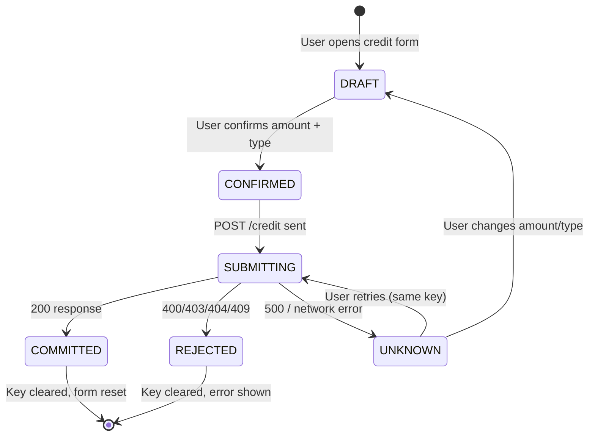
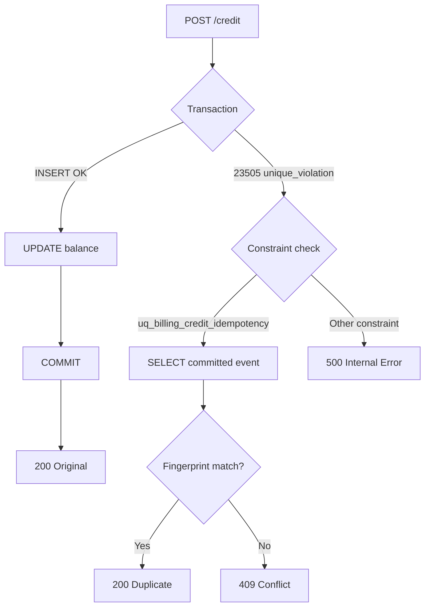

# 02-FINANCIAL-IDEMPOTENCY-SPEC: Credit Posting Idempotency

---

## 1. Problem Statement

Duplicate POST requests to the credit endpoint must produce exactly one balance
change. Network retries, browser refreshes, and concurrent admin actions must
not create double-credits.

## 2. Design

### Idempotency Key

- Client-generated UUID v4 (`crypto.randomUUID()`).
- Sent as `idempotency_key` in the request body.
- Stored in `billing_events.idempotency_key` (nullable TEXT).
- Partial unique index: `UNIQUE (tenant_id, idempotency_key) WHERE idempotency_key IS NOT NULL`.

### Transaction Flow

```
Client generates key → POST /credit { idempotency_key: key }
                                       ↓
                              BEGIN TRANSACTION
                              INSERT billing_event (key)
                              UPDATE tenant balance
                              COMMIT
                                       ↓
                              200 { billingEventId, newBalance }
```

### Duplicate Detection

If the INSERT violates the unique index (PostgreSQL 23505):

```
INSERT → 23505 unique_violation
         constraint = uq_billing_credit_idempotency
              ↓
         ROLLBACK (automatic)
              ↓
         SELECT committed event by (tenant_id, idempotency_key)
              ↓
         Validate fingerprint matches
              ↓
         200 { duplicate: true, billingEventId, newBalance }
```

### Fingerprint Validation

On duplicate detection, verify the committed event matches the retry request:

| Field | Comparison |
|-------|-----------|
| `eventType` | Must match exactly |
| `amountXlm` | Must match exactly (string comparison) |
| `bundlePurchaseId` (bundle_purchase only) | Must exist, belong to same tenant |
| `bundleSlugSnapshot` (bundle_purchase only) | Must match linked record |
| `paymentReference` (bundle_purchase only) | Must match linked record |

Mismatch → HTTP 409 with `"different parameters"` error.

## 3. Error Handling

| Scenario | HTTP Status | Key Cleared? |
|----------|-------------|-------------|
| First successful credit | 200 | Yes |
| Duplicate (same params) | 200 + `duplicate: true` | Yes |
| Duplicate (different params) | 409 | Yes (frontend) |
| Validation error | 400 | Yes (frontend) |
| Auth failure | 401/403 | Kept (401), Yes (403) |
| Tenant not found | 404 | Yes (frontend) |
| Server error | 500 | Kept |
| Network error | N/A | Kept |

## 4. Drizzle Error Unwrapping (REV-02 Fix)

Drizzle ORM wraps postgres.js errors. The outer error has `code: undefined`.
The actual PG error is on `err.cause`:

```typescript
const pgError = err.cause ?? err;
const pgCode = pgError.code ?? err.code;
const constraintName = pgError.constraint_name ?? pgError.constraint ?? "";
```

## 5. Constraint Identification (REV-07 Fix)

Only match the exact constraint name. Empty constraint names are rejected:

```typescript
if (constraintName === "uq_billing_credit_idempotency") { ... }
// NOT: constraintName === "uq_billing_credit_idempotency" || constraintName === ""
```

## 6. Diagrams

### Credit Lifecycle State Machine



### Concurrent PostgreSQL Credit Transactions

```mermaid
sequenceDiagram
    participant A as Request A
    participant B as Request B
    participant PG as PostgreSQL
    
    A->>PG: BEGIN; INSERT (key=X)
    B->>PG: BEGIN; INSERT (key=X)
    PG-->>A: INSERT OK, UPDATE balance
    A->>PG: COMMIT
    PG-->>B: ERROR 23505 (unique_violation)
    B->>PG: ROLLBACK (automatic)
    B->>PG: SELECT WHERE key=X (new read)
    PG-->>B: committed event
    B->>B: Validate fingerprint
    B-->>B: Return 200 { duplicate: true }
```

### API Recovery After Unique-Index Conflict


