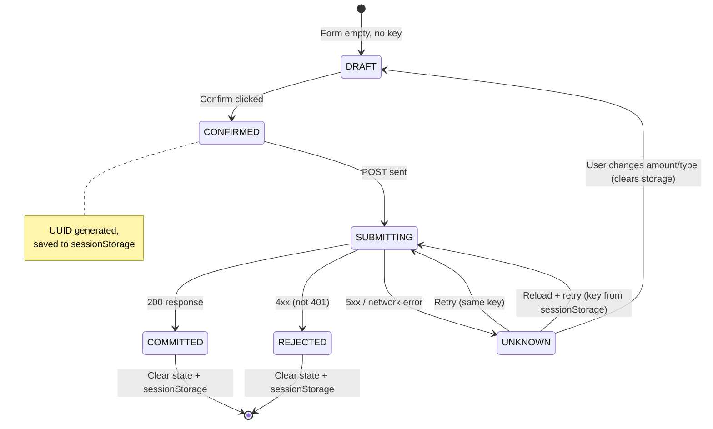
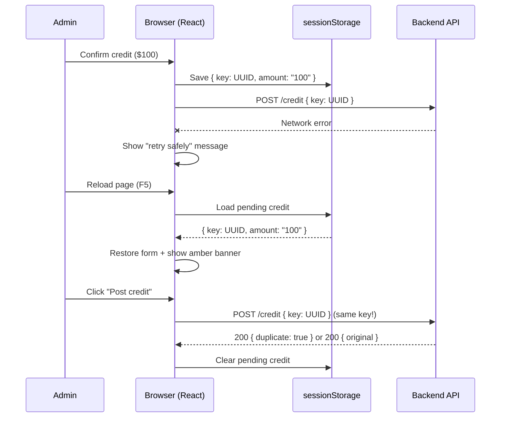

# 03-FRONTEND-RETRY-SPEC: Durable Credit Operation Identity (REV-01)

---

## 1. Problem

The `pendingCreditKey` UUID lived only in React state. Page reload after a
network error generated a new key, defeating idempotency protection.

## 2. Solution

Persist the idempotency key + immutable payload to `sessionStorage` scoped by
tenant ID. The key survives page reloads within the same browser session.

### Storage Key

```
aw_pending_credit_{tenantId}
```

### Storage Value

```json
{
  "key": "uuid-v4",
  "type": "manual_topup",
  "amount": "100.0000000"
}
```

## 3. Lifecycle



## 4. Implementation Details

### On Mount (useEffect)

```typescript
const restored = loadPendingCredit(id);
if (restored) {
  setPendingCreditKey(restored.key);
  setCreditType(restored.type);
  setCreditAmount(restored.amount);
  setCreditKeyRestored(true);
}
```

### On Confirm

```typescript
const newKey = crypto.randomUUID();
setPendingCreditKey(newKey);
savePendingCredit(id, { key: newKey, type: creditType, amount: trimmed });
```

### On Success (200)

```typescript
setPendingCreditKey(null);
clearPendingCredit(id);
```

### On Definitive Rejection (4xx, not 401)

```typescript
setPendingCreditKey(null);
clearPendingCredit(id);
```

### On Network Error / 5xx

Key and sessionStorage preserved — retry uses the same key.

### On Form Change (amount or type)

```typescript
setPendingCreditKey(null);
clearPendingCredit(id);
```

## 5. Visual Indicator

When a pending credit is restored from sessionStorage, an amber banner appears:

> Pending credit operation restored from previous session. Click "Post credit"
> to retry safely, or change the amount/type to start fresh. [Discard]

The Discard button clears the key and resets the form.

## 6. Frontend Reload and Retry Recovery



## 7. Edge Cases

| Scenario | Behavior |
|----------|----------|
| Two tabs for same tenant | Both read/write the same sessionStorage key; last-write-wins is safe because the key is the same UUID |
| Two tabs for different tenants | Separate storage keys (`aw_pending_credit_42` vs `aw_pending_credit_43`) |
| Session expires during retry | Admin redirected to login; key preserved in sessionStorage |
| Browser crashes | sessionStorage lost — new key generated (acceptable: idempotency still works server-side for the original request) |
| Admin changes amount then re-confirms | Old key cleared, new key generated with new amount |

## 8. File Changed

`packages/web-app/src/pages/AdminTenantDetail.tsx` — 90 insertions, 10 deletions.
