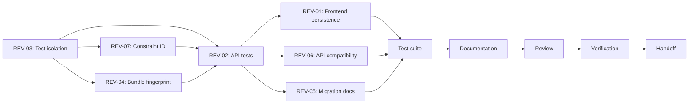

# 07-IMPLEMENTATION-PLAN: Phase 5.1 Remediation

---

## Execution Order

| Phase | Findings | Rationale |
|-------|----------|-----------|
| A | REV-03 | Test isolation must be established before running destructive DB tests |
| B | REV-07, REV-04, REV-02 | Backend financial integrity — fixes the core idempotency system |
| C | REV-01 | Frontend depends on backend being correct first |
| D | REV-06, REV-05 | Documentation and compatibility analysis — no code changes to core logic |
| E | All | Full test suite execution to verify no regressions |
| F | All | Documentation artifacts |
| G | All | Internal review cycle |
| H | All | Final verification table |
| I | All | Git handoff |

## Dependency Graph

## Commit Strategy

Each finding (or logical group) gets its own commit with:
- Descriptive commit message referencing finding ID(s)
- Test evidence in the commit
- No unrelated changes bundled
