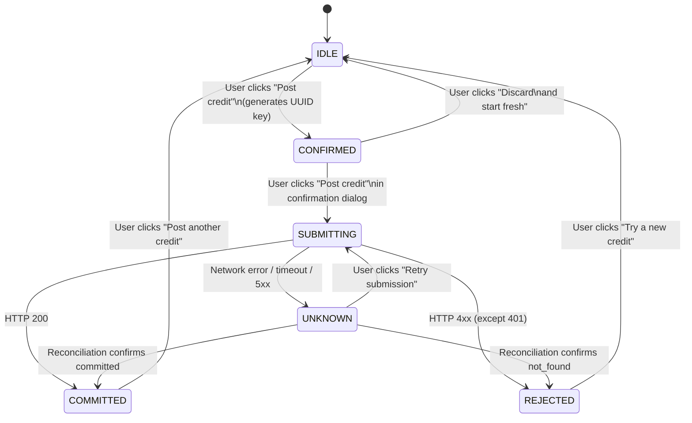
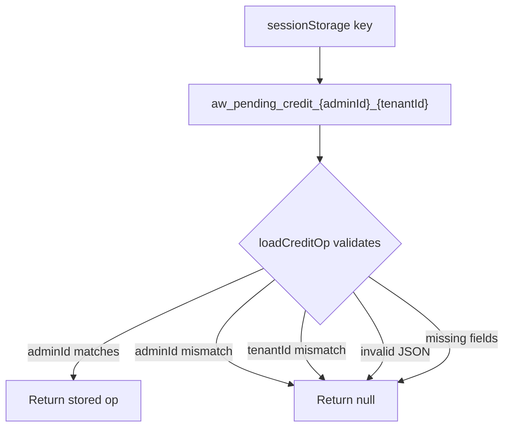
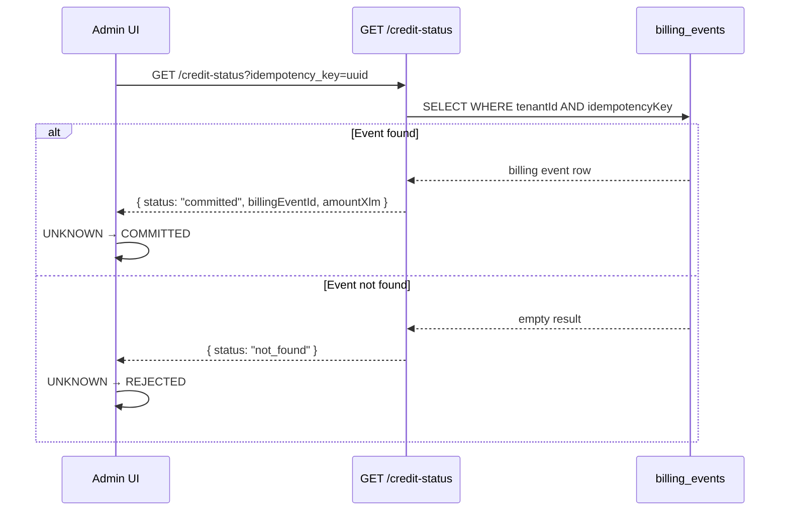
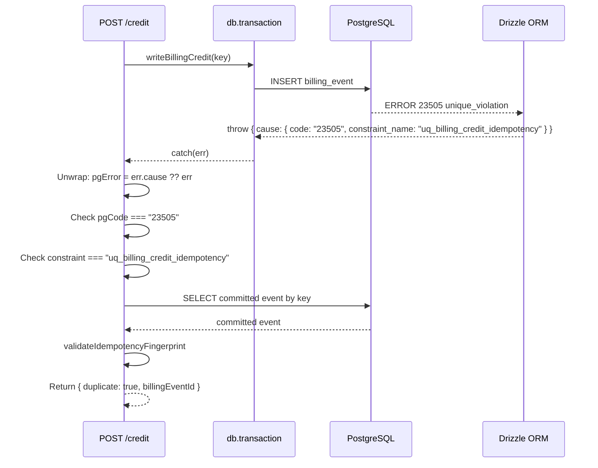
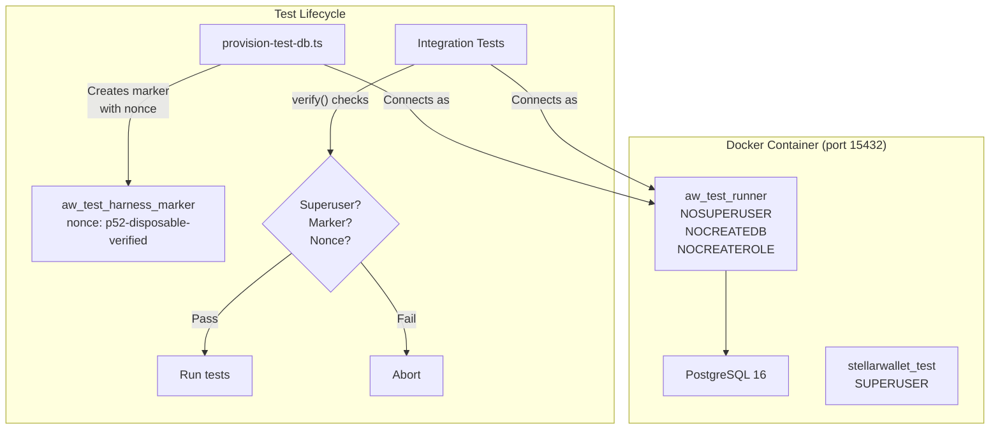
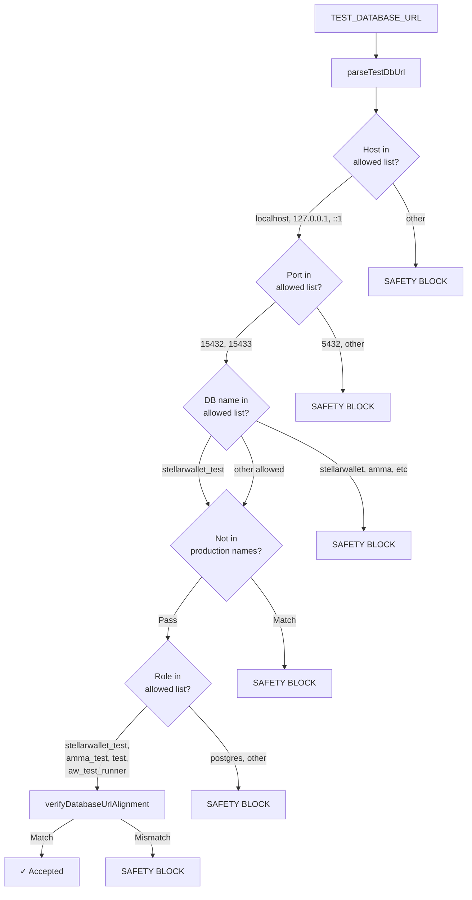
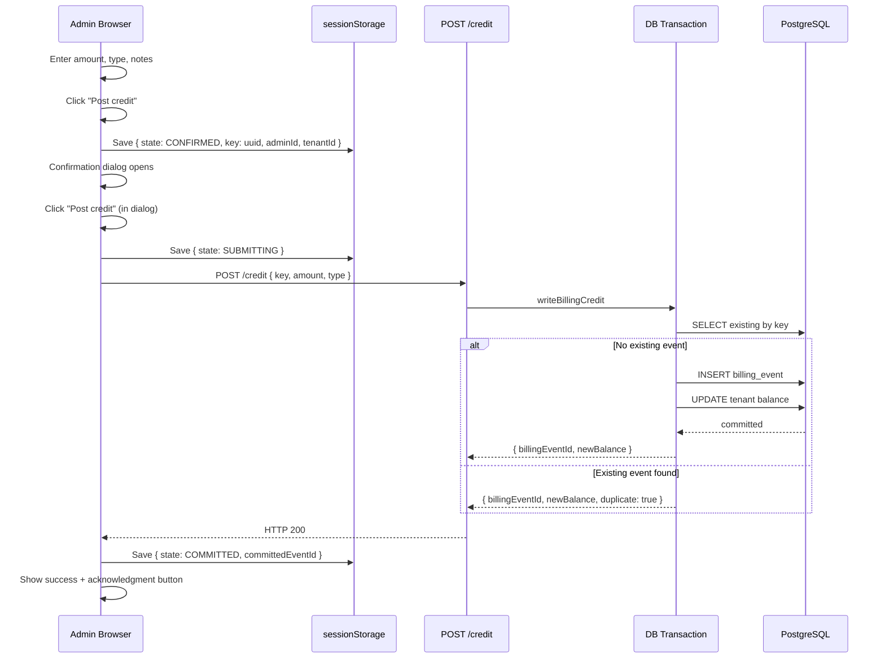
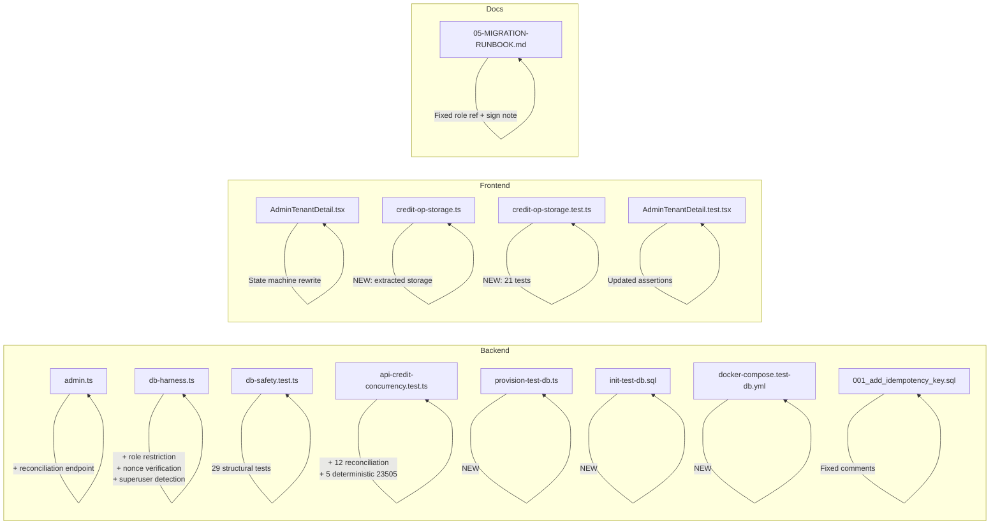

# 08-MERMAID-DIAGRAMS: Phase 5.2 Visual Documentation

## 1. Credit Operation State Machine

## 2. sessionStorage Scoping

## 3. Reconciliation Flow

## 4. 23505 Recovery Path

## 5. Test Database Isolation Architecture

## 6. Database URL Validation Chain

## 7. Credit Posting End-to-End Flow

## 8. Phase 5.2 File Change Map

