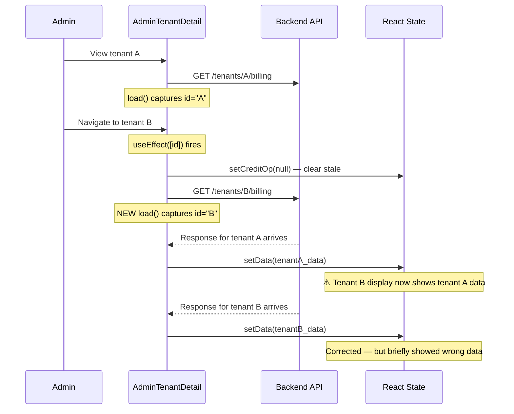
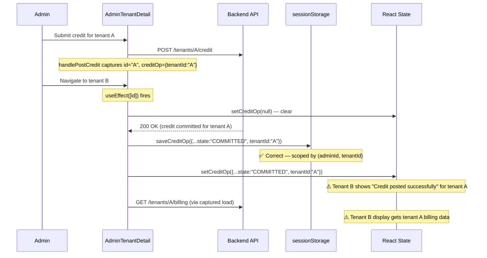
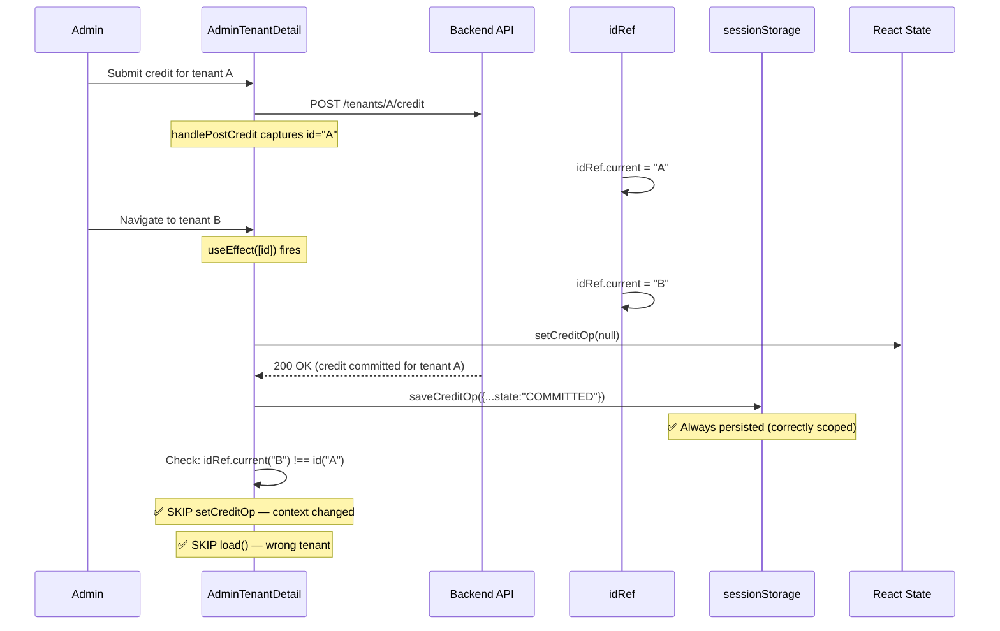
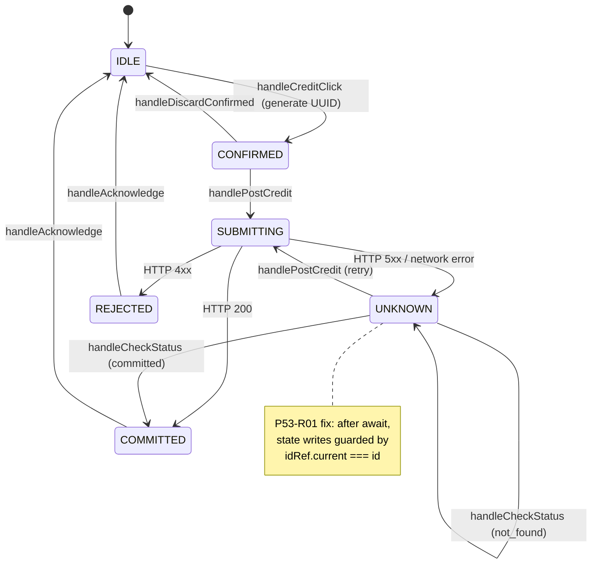
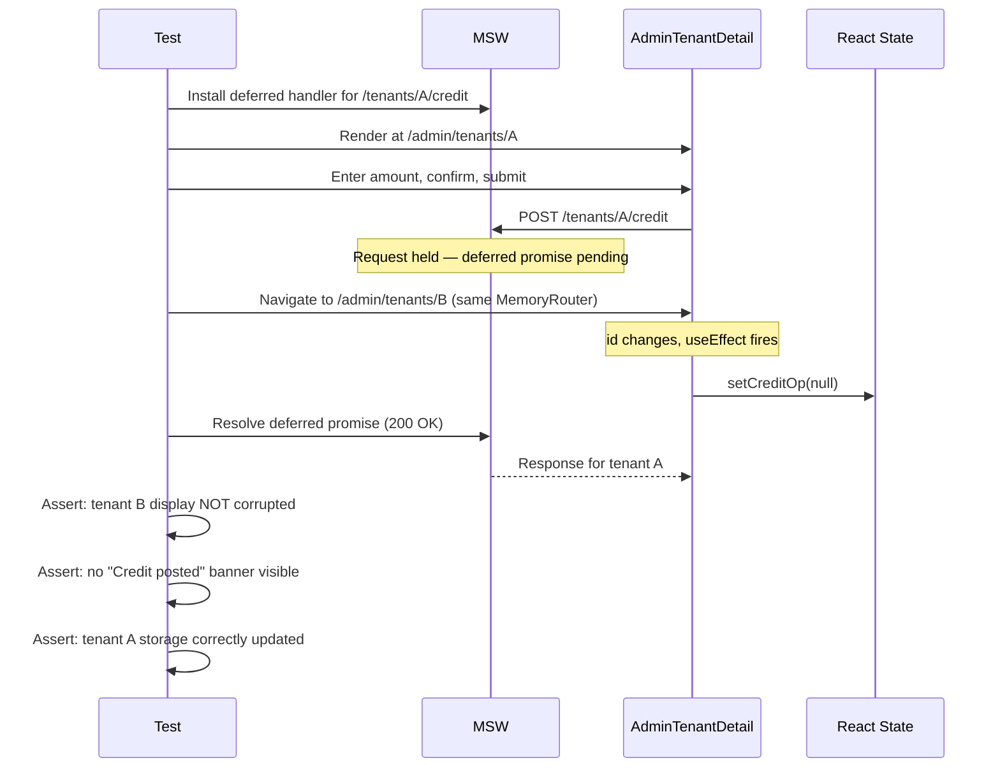

# 05 — Diagrams

## Diagram 1: Current Defect — Stale Response Overwrites State

## Diagram 2: Current Defect — Credit Response on Wrong Tenant

## Diagram 3: Fixed Behavior — Context Ref Guard

## Diagram 4: State Machine (Unchanged from P53)

## Diagram 5: Test Pattern — Same-Component Navigation with Deferred Promise

