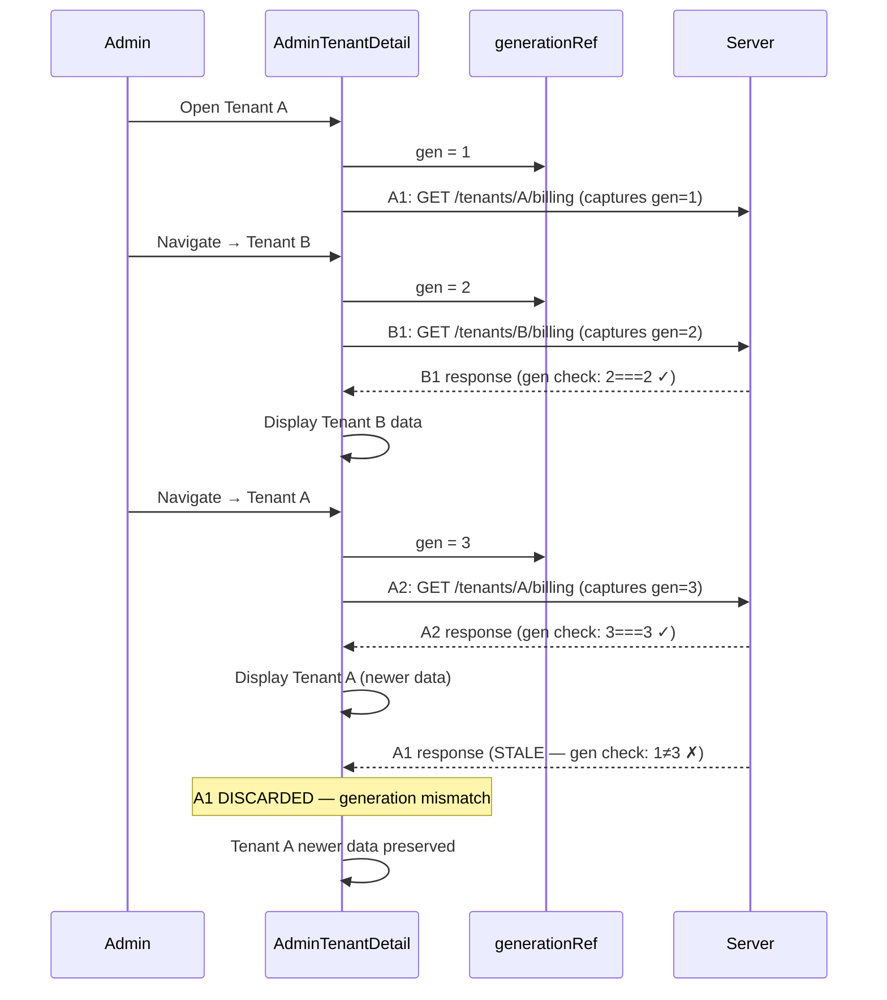
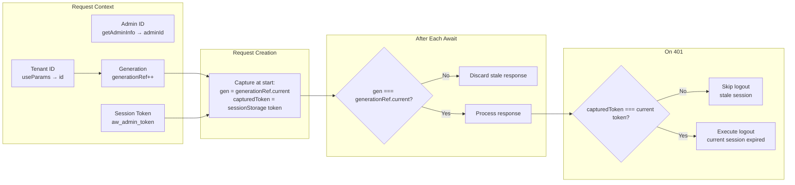
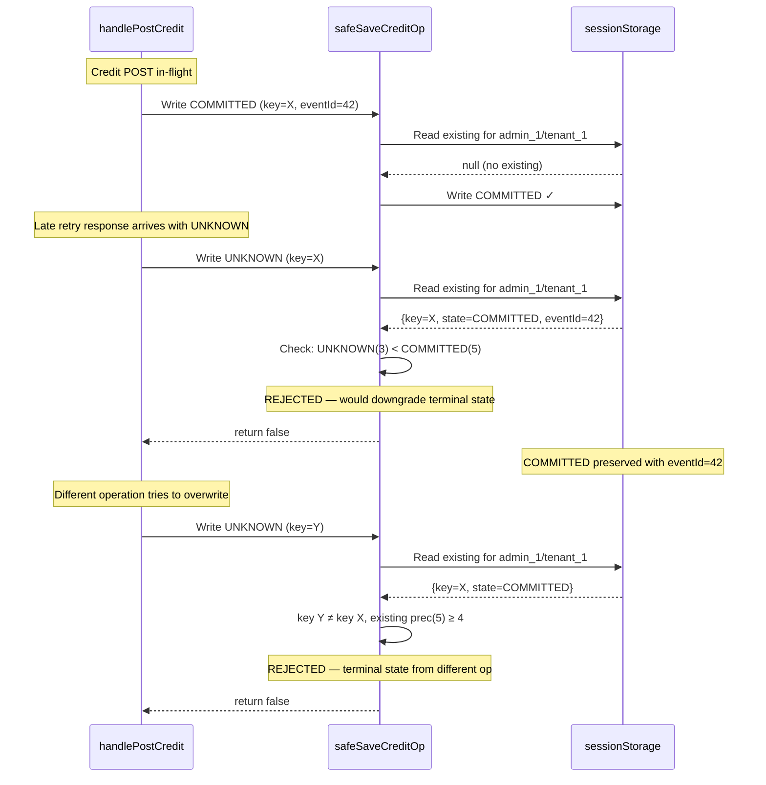
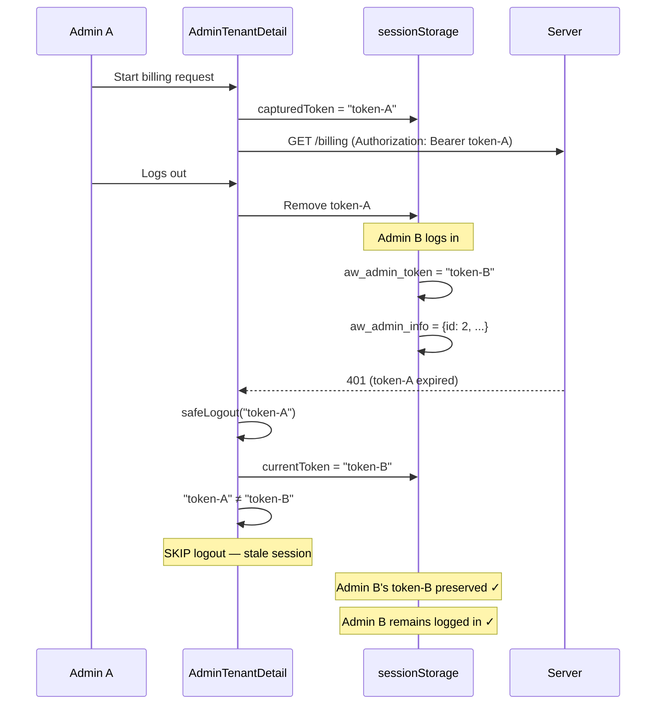
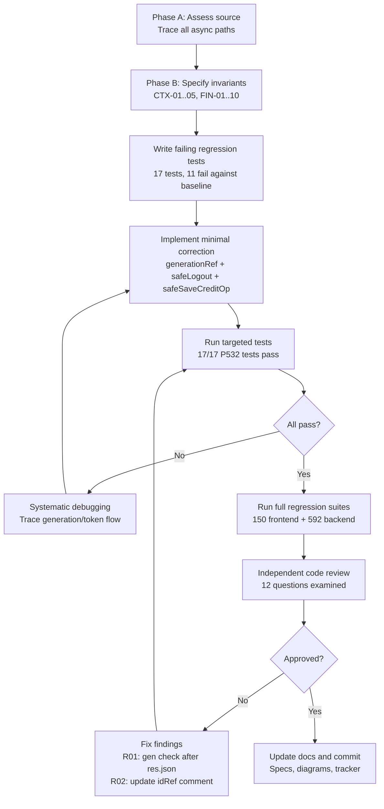
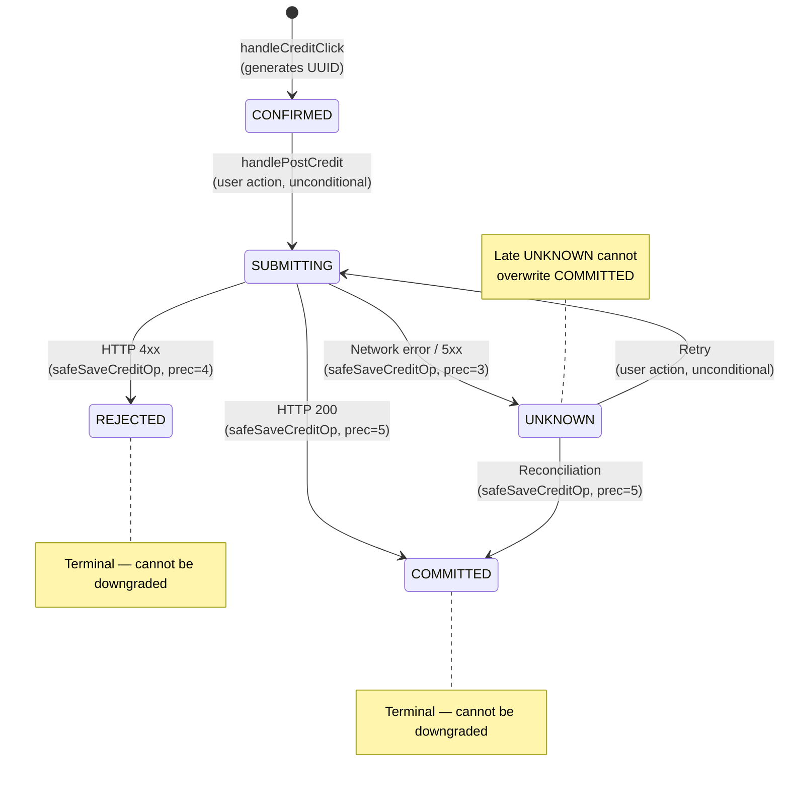

# Phase 5.3.2 — Mermaid Diagrams

## Diagram 1 — A → B → A Request Race

## Diagram 2 — Request Identity Lifecycle

## Diagram 3 — Financial Result Persistence

## Diagram 4 — Stale HTTP 401

## Diagram 5 — TDD and Verification Loop

## Diagram 6 — State Precedence for safeSaveCreditOp

