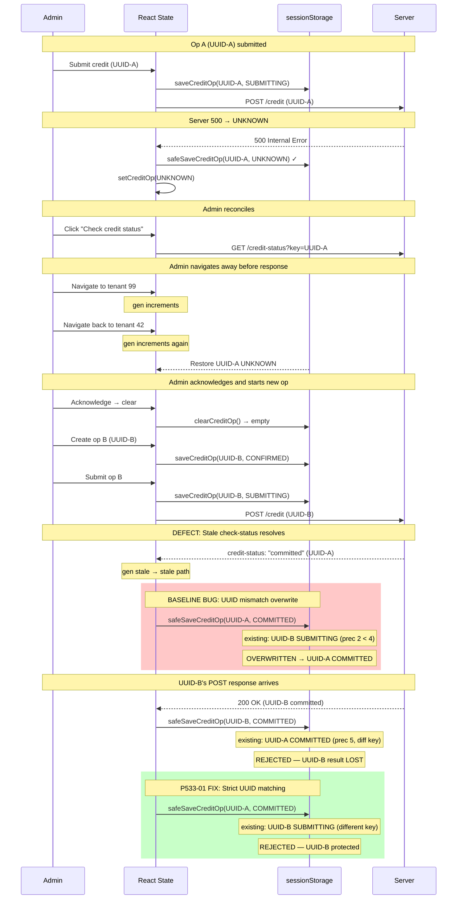
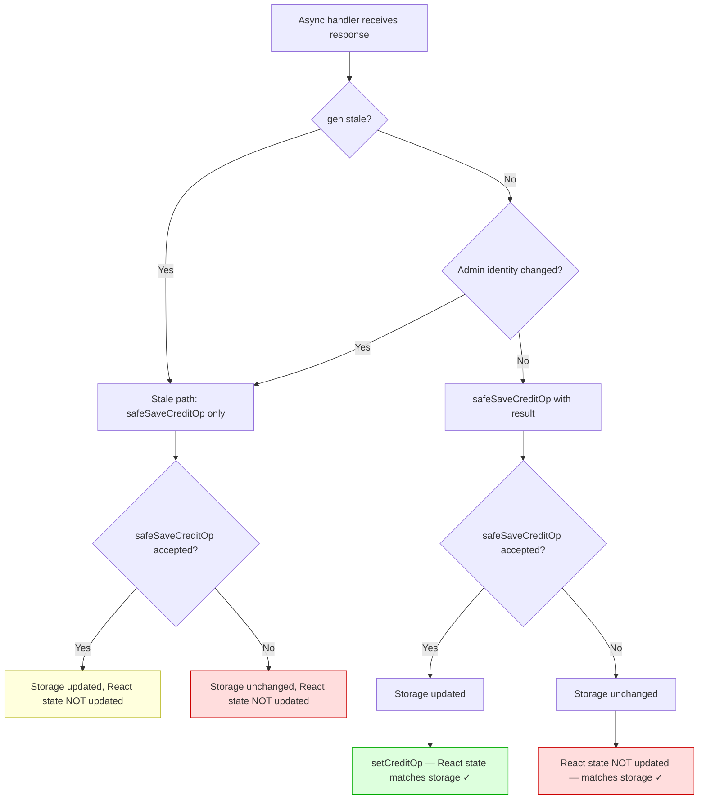
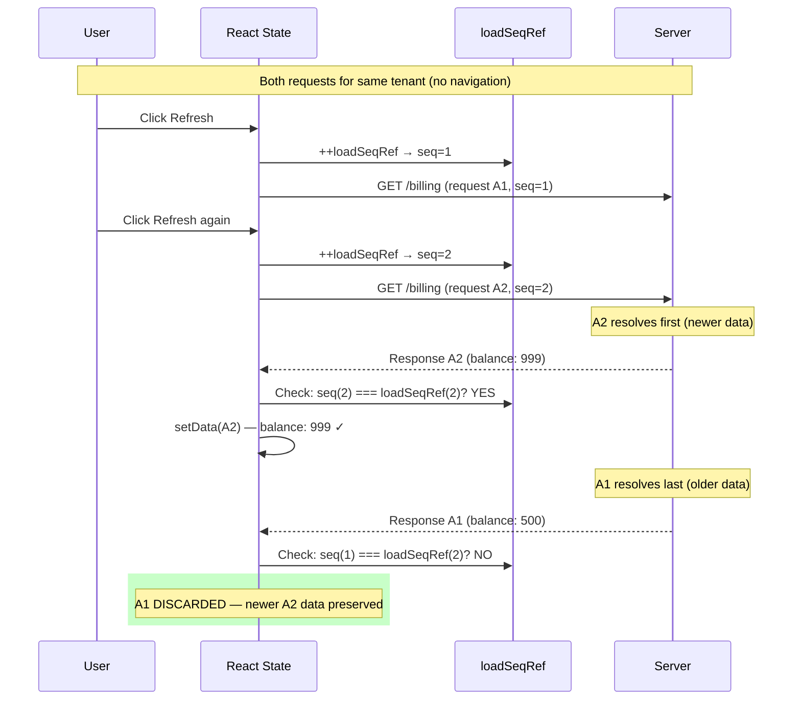
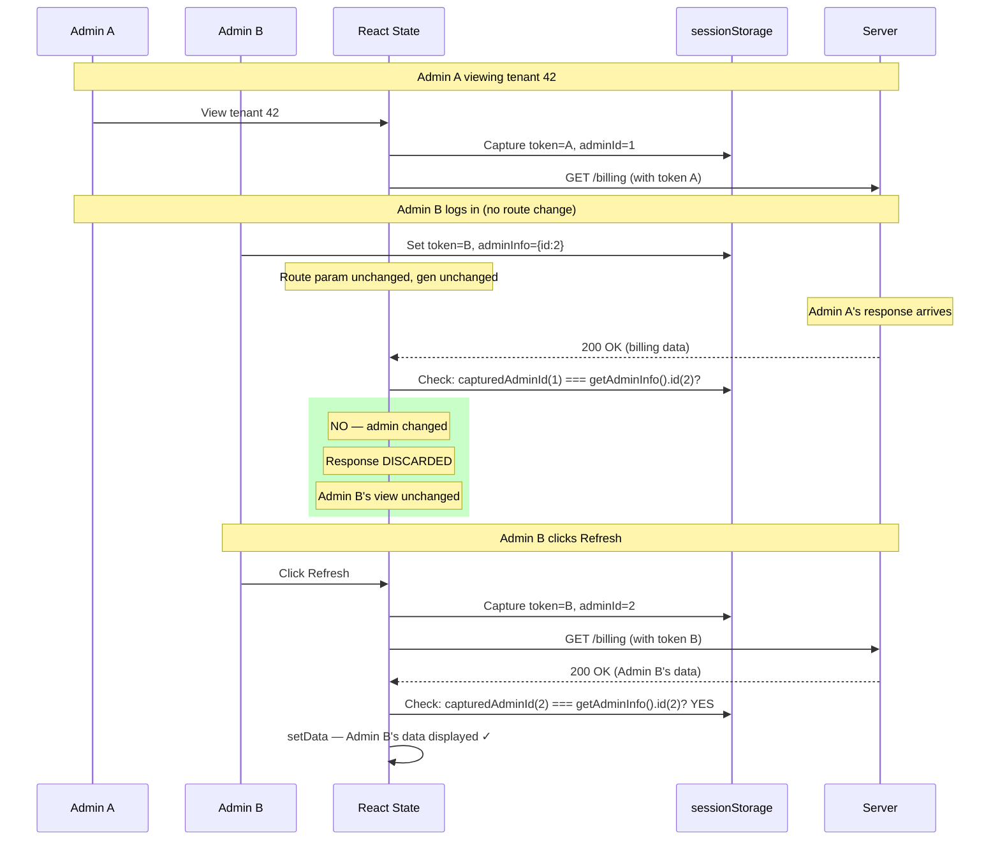
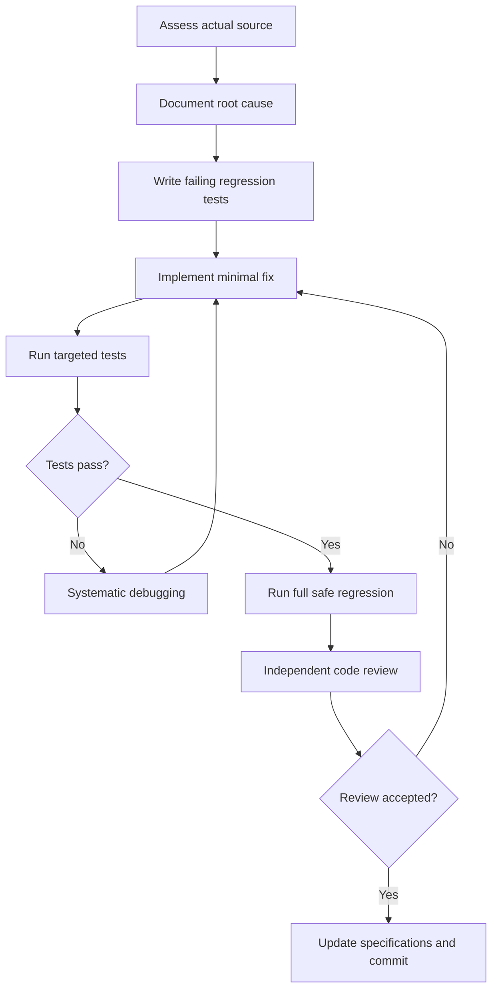

# Phase 5.3.3 — Mermaid Diagrams

## Diagram 1 — Different-UUID Overwrite Race



## Diagram 2 — Financial Operation Persistence Rules

```mermaid
stateDiagram-v2
    direction LR

    [*] --> empty: No record

    empty --> CONFIRMED: save (new op)
    empty --> COMMITTED: save (stale evidence)

    state "Same UUID" as same {
        CONFIRMED --> SUBMITTING: upgrade ✓
        SUBMITTING --> UNKNOWN: upgrade ✓
        SUBMITTING --> REJECTED: upgrade ✓
        SUBMITTING --> COMMITTED: upgrade ✓
        UNKNOWN --> COMMITTED: upgrade ✓
        UNKNOWN --> UNKNOWN: equal ✓
        REJECTED --> COMMITTED: upgrade ✓
    }

    state "Same UUID (blocked)" as blocked {
        COMMITTED --> UNKNOWN: downgrade ✗
        COMMITTED --> REJECTED: downgrade ✗
        COMMITTED --> SUBMITTING: downgrade ✗
        COMMITTED --> CONFIRMED: downgrade ✗
        UNKNOWN --> SUBMITTING: downgrade ✗
        UNKNOWN --> CONFIRMED: downgrade ✗
        REJECTED --> UNKNOWN: downgrade ✗
    }

    state "Different UUID (all blocked)" as diffuuid {
        note left of diffuuid
            P533-01 FIX:
            ANY state → different UUID = REJECTED
            Regardless of precedence
        end note
    }

    CONFIRMED --> [*]: clearCreditOp (acknowledge)
    COMMITTED --> [*]: clearCreditOp (acknowledge)
    REJECTED --> [*]: clearCreditOp (acknowledge)
```

## Diagram 3 — React State and Storage Consistency



## Diagram 4 — Same-Route Overlapping Requests



## Diagram 5 — Administrator Switching



## Diagram 6 — Autonomous Verification Cycle


