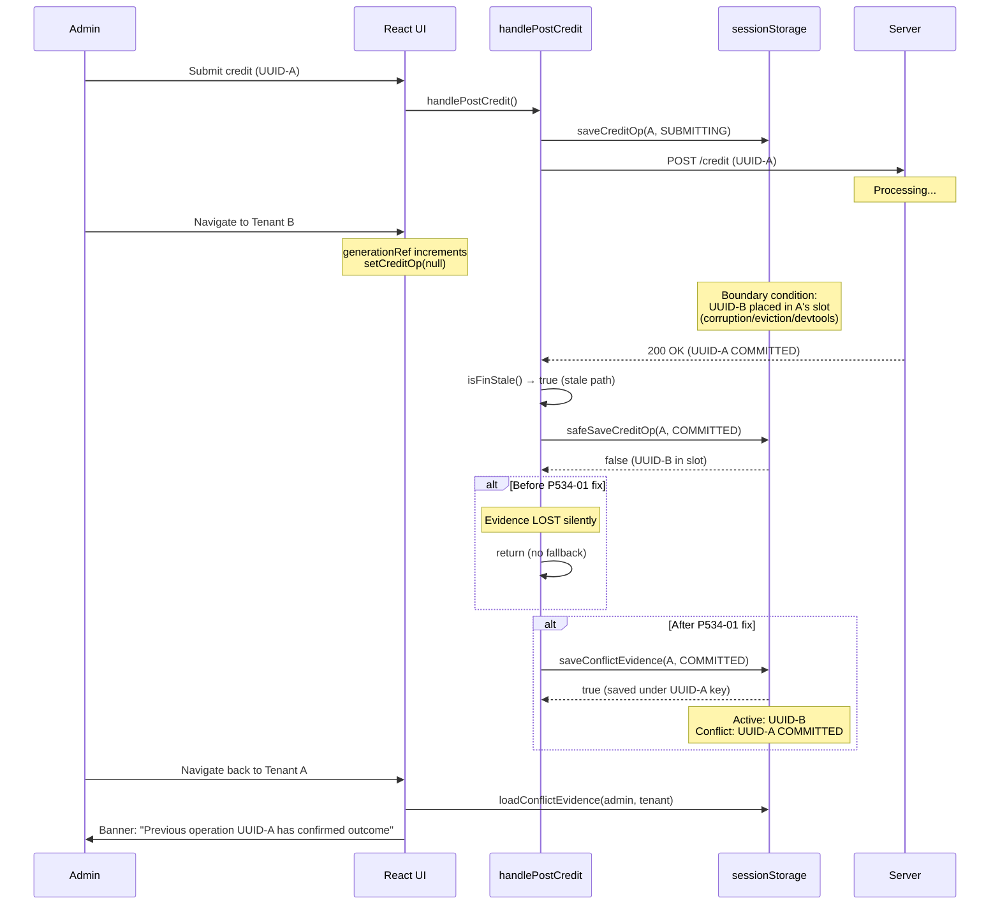
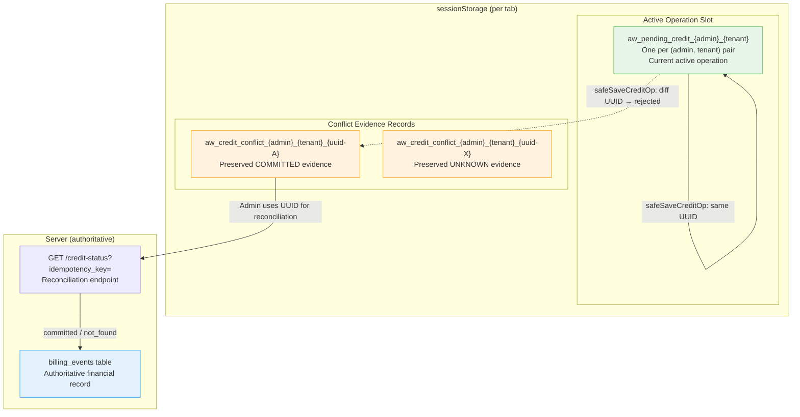
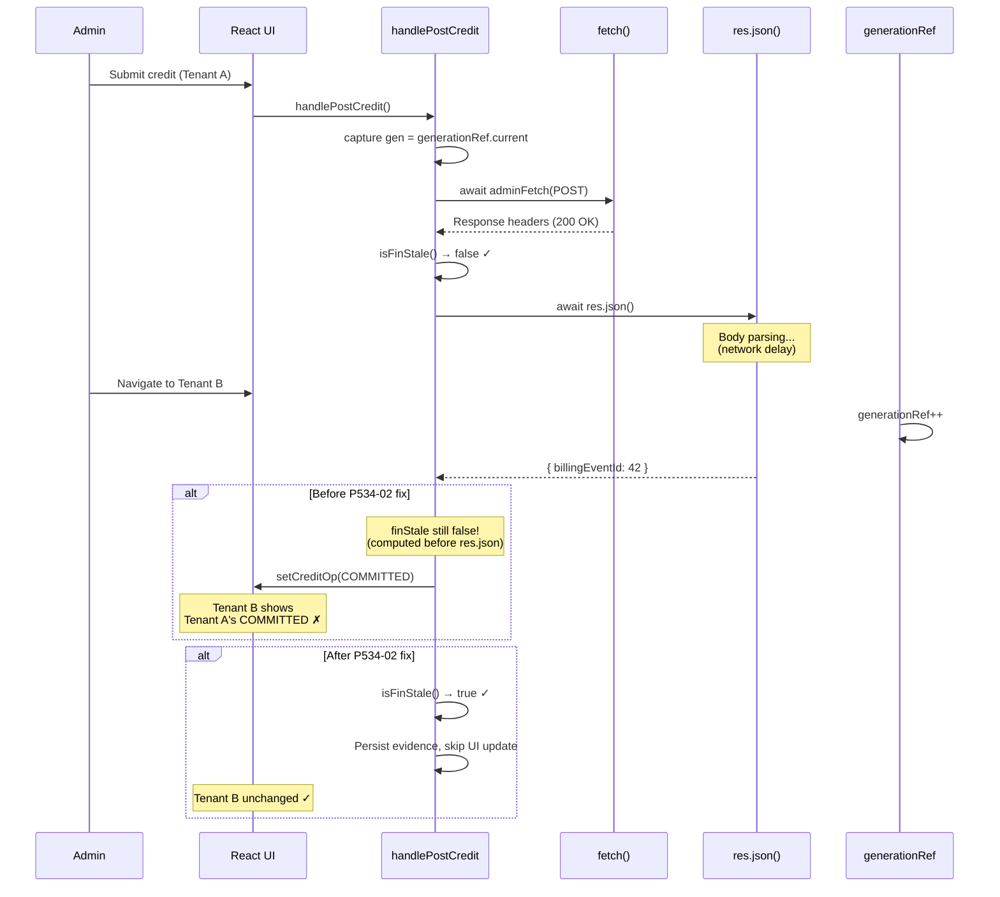
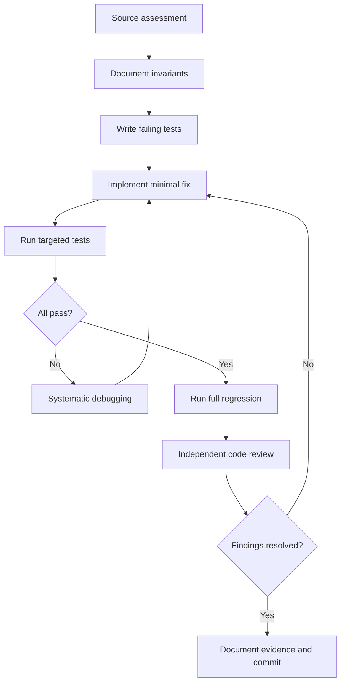
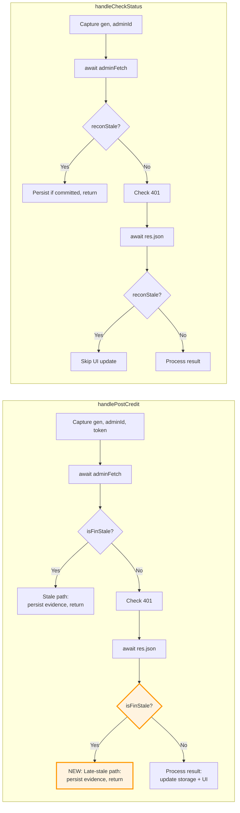

# Phase 5.3.4 — Mermaid Diagrams

## Diagram 1 — Conflicting UUID Financial Response



## Diagram 2 — Financial Evidence and Active Operation Separation



## Diagram 3 — Async Response-Body Race (P534-02)



## Diagram 4 — Financial State Transitions

```mermaid
stateDiagram-v2
    [*] --> IDLE: No operation

    IDLE --> CONFIRMED: handleCreditClick()<br/>Generate UUID

    CONFIRMED --> SUBMITTING: handlePostCredit()<br/>Same UUID
    CONFIRMED --> IDLE: handleDiscardConfirmed()

    SUBMITTING --> COMMITTED: HTTP 200<br/>Same UUID, precedence ✓
    SUBMITTING --> REJECTED: HTTP 4xx<br/>Same UUID, precedence ✓
    SUBMITTING --> UNKNOWN: HTTP 5xx / Network error<br/>Same UUID, precedence ✓

    UNKNOWN --> SUBMITTING: Retry submission<br/>Same UUID
    UNKNOWN --> COMMITTED: Reconciliation confirms<br/>Same UUID, precedence ✓

    COMMITTED --> IDLE: handleAcknowledge()
    REJECTED --> IDLE: handleAcknowledge()

    state "Cross-UUID Protection" as cross {
        note left of cross
            safeSaveCreditOp rejects
            when existing.key ≠ op.key.
            
            P534-01: Rejected COMMITTED
            evidence → conflict record.
            
            COMMITTED ✗→ UNKNOWN (precedence)
            COMMITTED ✗→ REJECTED (precedence)
        end note
    }
```

## Diagram 5 — TDD Development Loop



## Diagram 6 — Context Revalidation Points


