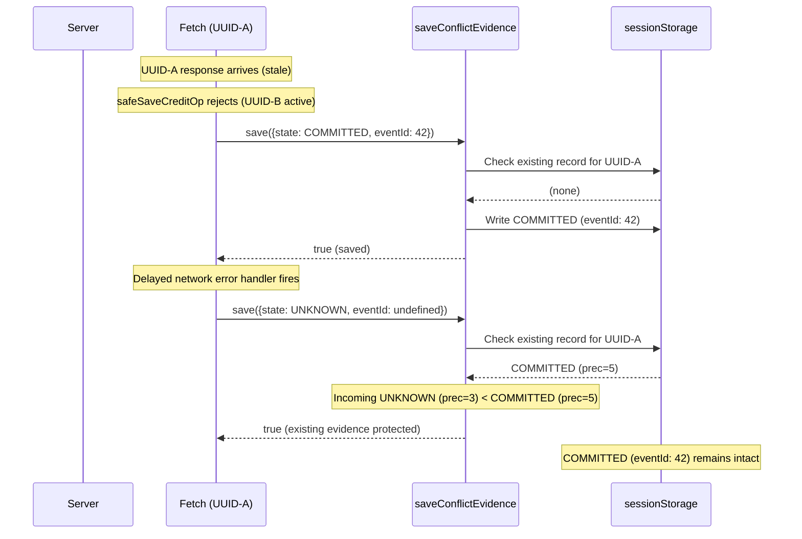
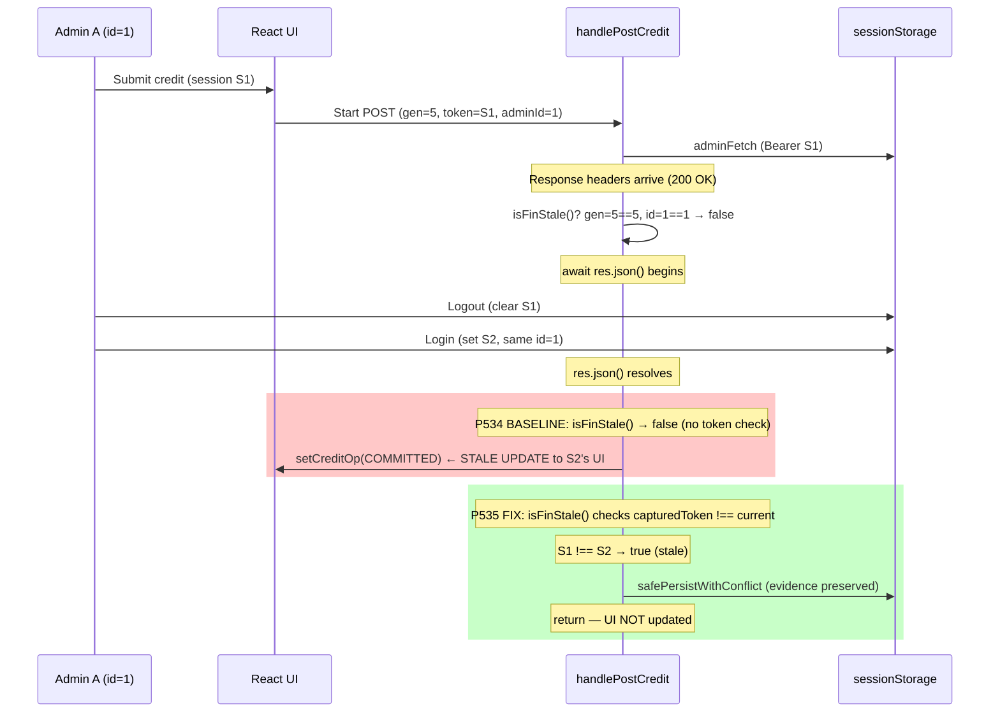
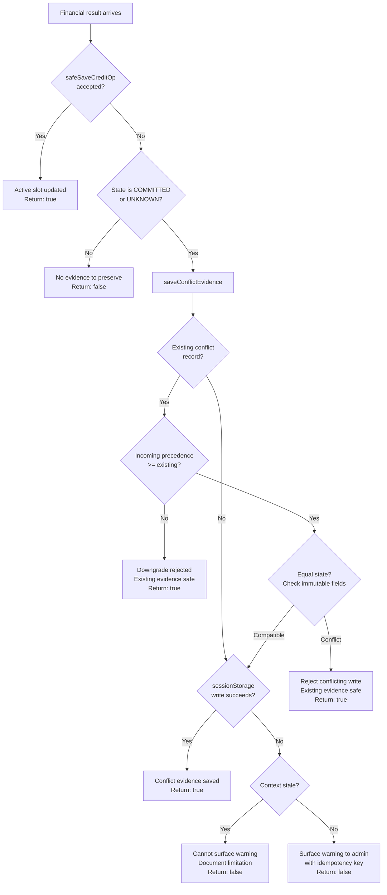

# Phase 5.3.5 — Mermaid Diagrams

## Diagram A: COMMITTED evidence protected from delayed UNKNOWN (R01)

## Diagram B: Same-admin session S1 → S2 during res.json() (R02)

## Diagram C: Conditional financial persistence decision tree (R03)

