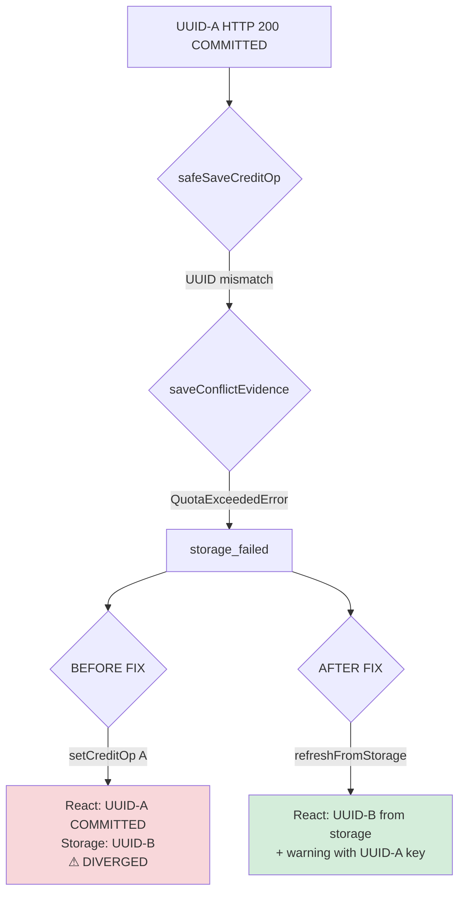
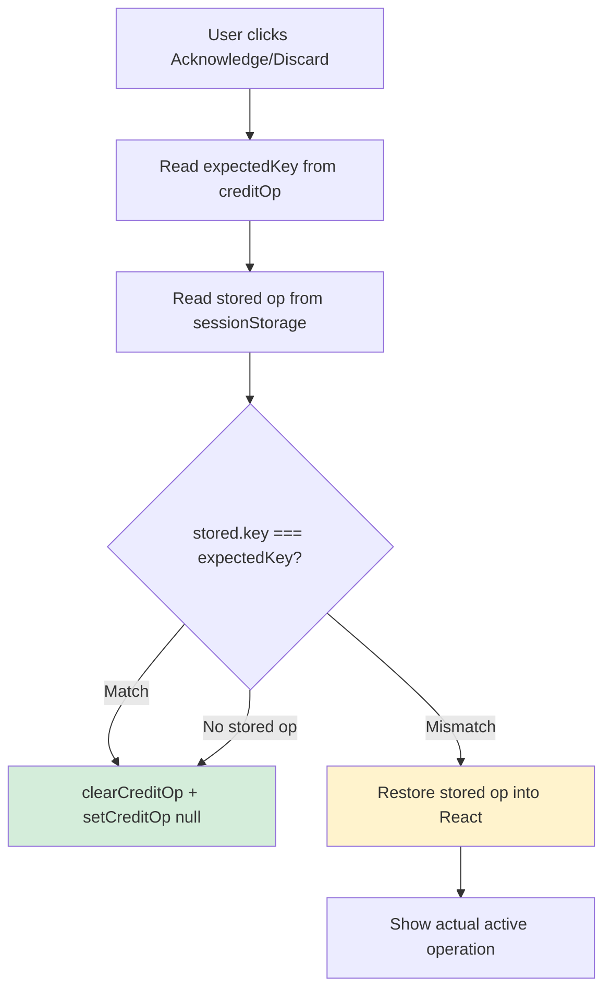
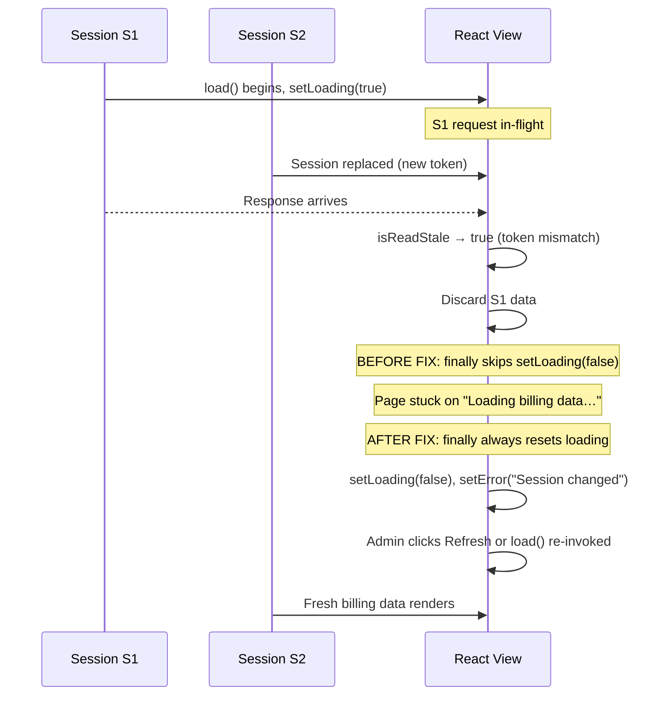
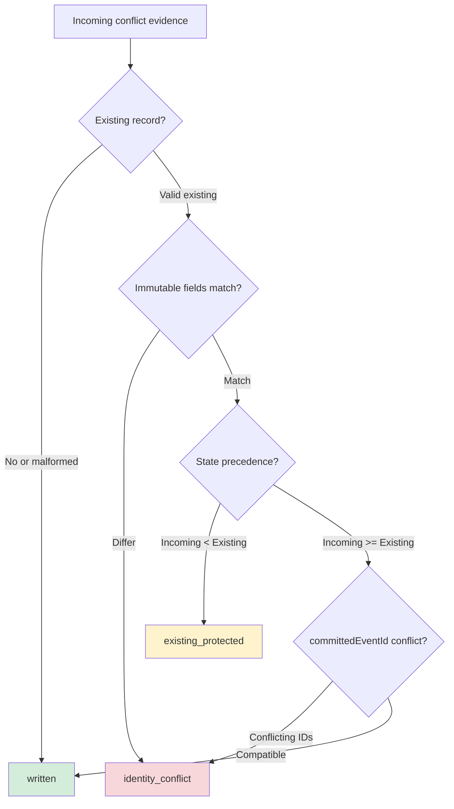

# Phase 5.3.7 — Mermaid Diagrams

## Diagram 1 — Storage failure with active collision (P537-01)

## Diagram 2 — UUID-bound acknowledge/discard (P537-02)

## Diagram 3 — Session recovery after S1 discard (P537-03)

## Diagram 4 — Conflict evidence validation outcomes (P537-04)

