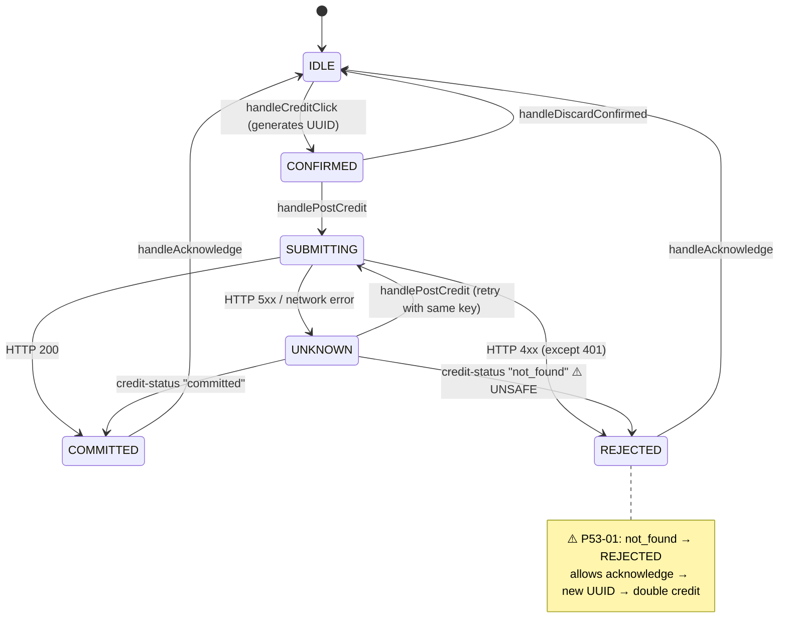
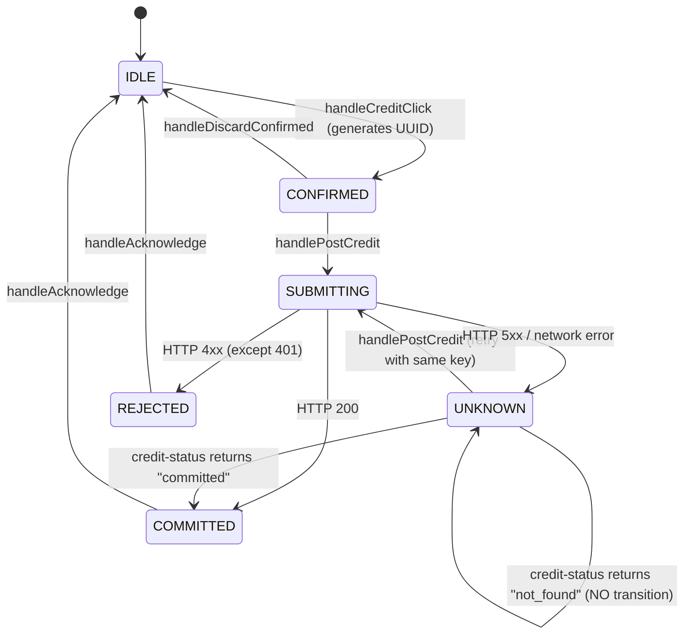

# 04 — Credit State Machine Specification

## P53-01: Financial Reconciliation Race — Solution Design

### Option A: Keep UNKNOWN on `not_found` (SELECTED)

**Change:** When credit-status returns `not_found`, display an informational message but keep the operation in UNKNOWN state. Do not transition to REJECTED. Preserve the original idempotency key.

**Pros:**
- Minimal code change (remove 6 lines, add informational message).
- Preserves financial safety: no false finalization.
- The admin can retry with the same key (safe due to backend idempotency).
- The admin can check status again later.
- No backend changes required.

**Cons:**
- The admin cannot automatically clear an UNKNOWN operation that genuinely never committed. They must retry (which is safe) or manually assess.
- No "authoritative negative" path exists without a server-side operation registry.

### Option B: Introduce a retry counter with eventual rejection

**Change:** After N consecutive `not_found` responses with increasing delays, transition to a "LIKELY_REJECTED" state that allows acknowledgment.

**Pros:**
- Provides an eventual escape from UNKNOWN for operations that genuinely never committed.
- Heuristic approach: if a transaction hasn't committed after 5 checks over several minutes, it very likely never will.

**Cons:**
- Heuristic is not authoritative — a slow transaction could still commit after the threshold.
- More complex implementation (counter, timing, new state).
- Still risks double-credit in edge cases.
- Violates INV-2 and INV-3.

### Option C: Server-side operation registry / cancellation protocol

**Change:** Add a server-side `pending_operations` table. The frontend registers an operation before submission. The backend marks it committed/failed. The reconciliation endpoint can authoritatively distinguish "never received" from "received but not yet committed."

**Pros:**
- Only approach that can provide authoritative negative finalization.
- Eliminates the ambiguity window entirely.

**Cons:**
- Requires backend changes (new table, new endpoints, migration).
- Significantly more complex.
- Out of scope for P53-01 (explicitly frontend-focused).
- Documents as a deferred architectural enhancement.

### Selected: Option A

Rationale: It is the smallest safe solution. It does not provide authoritative negative finalization, but it prevents the dangerous false-negative path. The admin retains the ability to retry (safe via idempotency) or wait and check again. If authoritative negative finalization is ever needed, Option C should be considered as a separate project.

## Diagram 1 — Existing Credit Lifecycle (UNSAFE)

## Diagram 2 — Proposed Credit Lifecycle (SAFE)

### Conditions for terminal states

- **COMMITTED:** Only via HTTP 200 from credit POST, or `"committed"` from credit-status GET.
- **REJECTED:** Only via HTTP 4xx (except 401) from credit POST. Never via credit-status.
- **`not_found` alone does NOT authorize UNKNOWN → REJECTED.**

### State Descriptions

| State | Meaning | Allowed Actions |
|-------|---------|-----------------|
| IDLE (null) | No active operation | Create new operation |
| CONFIRMED | Operation created, UUID assigned, awaiting admin confirmation | Submit, Discard |
| SUBMITTING | HTTP request in-flight | None (wait) |
| COMMITTED | Credit confirmed applied | Acknowledge (return to IDLE) |
| REJECTED | Credit authoritatively rejected by server (4xx) | Acknowledge (return to IDLE) |
| UNKNOWN | Outcome uncertain (timeout, 5xx, lost response) | Retry (resubmit with same key), Check status |

### Transition Rules

1. **IDLE → CONFIRMED:** Only when no existing operation. Generates immutable UUID.
2. **CONFIRMED → SUBMITTING:** `handlePostCredit` sends POST with operation's key.
3. **SUBMITTING → COMMITTED:** HTTP 200 from credit endpoint.
4. **SUBMITTING → REJECTED:** HTTP 400/403/404/409 from credit endpoint.
5. **SUBMITTING → UNKNOWN:** HTTP 5xx, network timeout, or caught exception.
6. **UNKNOWN → SUBMITTING:** Retry with original key and payload.
7. **UNKNOWN → COMMITTED:** `credit-status` returns `"committed"`.
8. **UNKNOWN → UNKNOWN:** `credit-status` returns `"not_found"` — NO state change.
9. **COMMITTED → IDLE:** Explicit acknowledgment clears operation.
10. **REJECTED → IDLE:** Explicit acknowledgment clears operation.
11. **CONFIRMED → IDLE:** Explicit discard clears operation.

### Prohibited Transitions

- **UNKNOWN → REJECTED via `not_found`:** This transition is removed. It was the root cause of P53-01.
- **Any state → Any state with new UUID:** The UUID is immutable once generated.
- **COMMITTED/REJECTED → Any non-IDLE state:** Terminal states only exit via acknowledgment.

## API Response Semantics

| Endpoint | Response | Frontend interpretation |
|----------|----------|----------------------|
| POST credit | 200 | Committed (definitive positive) |
| POST credit | 200 + `duplicate:true` | Previously committed (safe retry result) |
| POST credit | 400 | Rejected — bad request, no write occurred |
| POST credit | 401 | Auth expired — logout, outcome unknown |
| POST credit | 403 | Rejected — insufficient role, no write occurred |
| POST credit | 404 | Rejected — tenant not found, no write occurred |
| POST credit | 409 | Rejected — idempotency conflict, original already committed with different params |
| POST credit | 5xx | Unknown — server error, write may have occurred |
| GET credit-status | 200 + "committed" | Committed (definitive positive) |
| GET credit-status | 200 + "not_found" | **Inconclusive** — no visible event, but write may still be in-flight |
| GET credit-status | 4xx/5xx | Check failed — stay UNKNOWN |
| Any endpoint | Network error | Unknown — outcome uncertain |

## Special Case: 409 on POST

The comment in the current code states: "If the original credit had committed, the retry with the same idempotency key would have returned 200 (duplicate=true), not 409."

This is correct. A 409 means the idempotency key exists but with different parameters (type/amount mismatch). This means:
- The original key was used for a different operation that DID commit.
- The current retry has mismatched parameters.
- Transitioning to REJECTED is correct for this case.

However, the current code does not distinguish between "409 because original committed with different params" and a hypothetical "409 from a concurrent insert race." The backend code explicitly handles the concurrent race via the 23505 recovery path, which returns 200. So 409 always means parameter mismatch, and REJECTED is safe.
