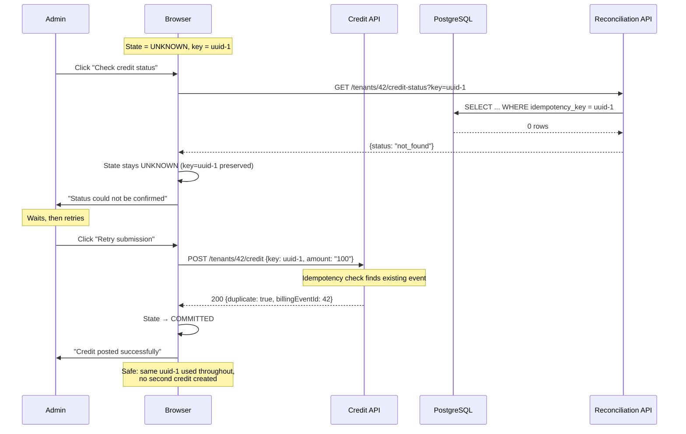
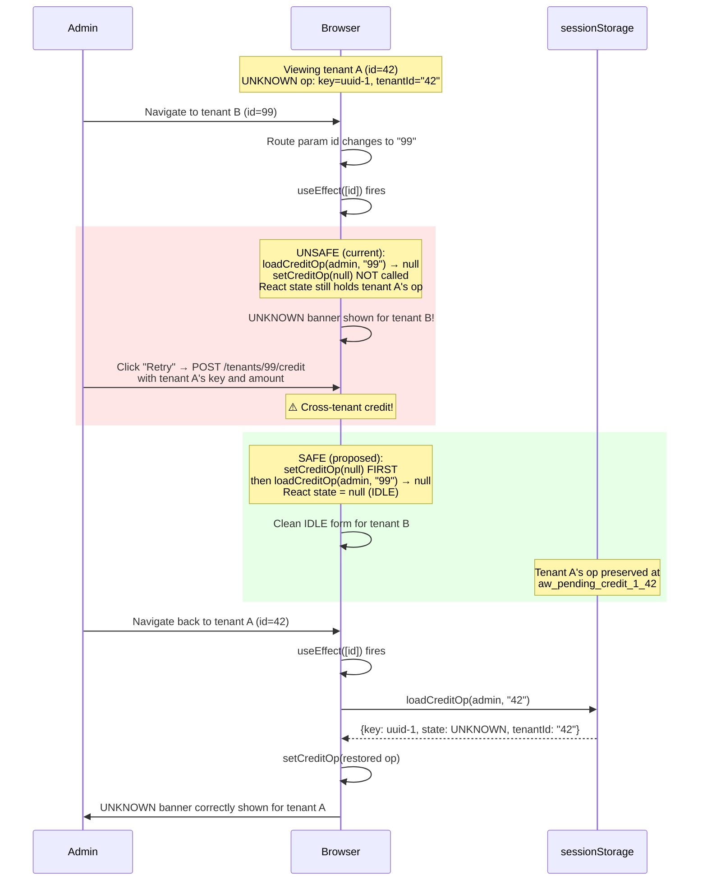
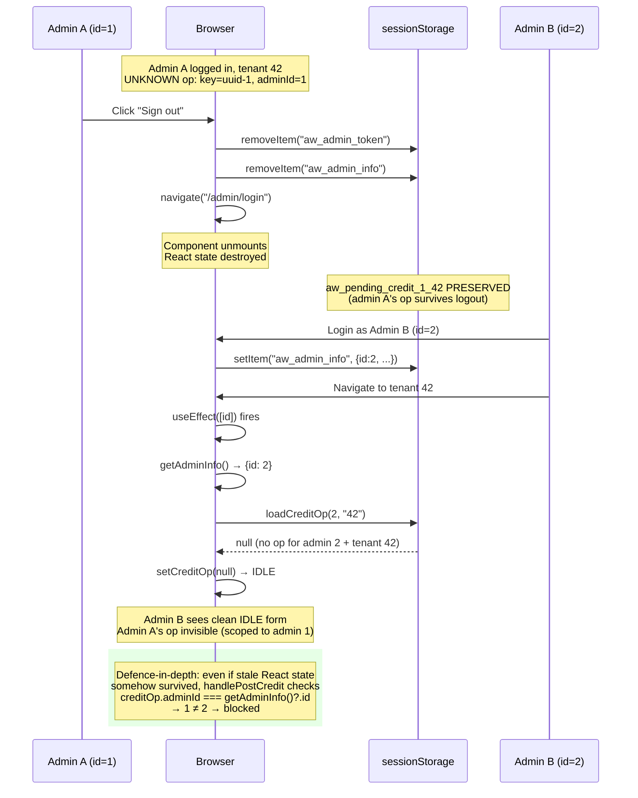

# 05 — Identity Boundary Specification

## P53-02: Tenant and Administrator Context Safety — Solution Design

### Option A: Fix `useEffect` + defence-in-depth guards (SELECTED)

**Changes:**
1. In the `useEffect([id])`, always set `setCreditOp(null)` before attempting restoration. This ensures stale state from a previous tenant is cleared regardless of whether the new tenant has a stored operation.
2. Add runtime identity checks in `handlePostCredit` and `handleCheckStatus`: verify `creditOp.tenantId === id` and `creditOp.adminId === currentAdminId` before any network call.
3. Clear related UI state (creditError, reconcileError) on tenant change.

**Pros:**
- Minimal code change (3–4 lines in useEffect, 6–8 lines for guards).
- Fixes the primary bug (stale React state on navigation).
- Defence-in-depth guards protect against any future failure to clear state.
- No backend changes.
- No new component architecture.

**Cons:**
- Does not architecturally prevent the problem (React state is still mutable). But the combination of clearing + guards provides practical safety.

### Option B: Derive creditOp from storage on every render

**Change:** Remove `creditOp` from React state entirely. Instead, derive it from sessionStorage on every render using a `useMemo` that reads from storage keyed by current (adminId, id).

**Pros:**
- Eliminates stale state by construction — always reads current context.
- No possibility of displaying wrong tenant's operation.

**Cons:**
- sessionStorage reads on every render (performance cost, though negligible for this use case).
- Breaks the current `updateCreditOp` pattern which updates both storage and state atomically.
- Significant refactor of the component's state management.
- Risk of introducing new bugs during the refactor.

### Option C: Unmount component on tenant change (key prop)

**Change:** Add a `key={id}` prop to the AdminTenantDetail component in the router, forcing React to unmount and remount on every tenant change.

**Pros:**
- All React state is destroyed on tenant change — fresh start.
- Very clean solution from a React perspective.

**Cons:**
- Requires modifying the router configuration.
- Destroys all component state (loading, error, data, pagination) — forces full reload.
- Less targeted — affects the entire component, not just the credit operation state.

### Selected: Option A

Rationale: Smallest safe change. Directly addresses the root cause (missing `setCreditOp(null)`) and adds defence-in-depth without restructuring the component.

## Implementation Specification

### Fix 1: Clear stale state on tenant change

```typescript
// In useEffect([id]):
useEffect(() => {
  if (!id) return;
  
  // P53-02: ALWAYS clear stale operation state first
  setCreditOp(null);
  setCreditError(null);
  setReconcileError(null);
  
  const adminInfo = getAdminInfo();
  if (!adminInfo || typeof adminInfo.id !== "number") return;
  
  const restored = loadCreditOp(adminInfo.id, id);
  if (restored) {
    setCreditOp(restored);
    setCreditType(restored.type as "manual_topup");
    setCreditAmount(restored.amount);
    setCreditNotes(restored.notes ?? "");
  }
}, [id]);
```

### Fix 2: Identity guard before credit submission

```typescript
// In handlePostCredit, before the fetch:
if (creditOp.tenantId !== id) {
  setCreditError("Operation belongs to a different tenant. Please navigate to the correct tenant.");
  return;
}
const adminInfo = getAdminInfo();
if (!adminInfo || adminInfo.id !== creditOp.adminId) {
  setCreditError("Operation belongs to a different administrator. Please log in again.");
  return;
}
```

### Fix 3: Identity guard before reconciliation

```typescript
// In handleCheckStatus, before the fetch:
if (creditOp.tenantId !== id) {
  setReconcileError("Operation belongs to a different tenant.");
  return;
}
const adminInfo = getAdminInfo();
if (!adminInfo || adminInfo.id !== creditOp.adminId) {
  setReconcileError("Operation belongs to a different administrator.");
  return;
}
```

## Security Requirements

1. **No cross-tenant data flow:** An operation's financial payload (amount, type, notes) must never reach a different tenant's API endpoint.
2. **No cross-admin inheritance:** An administrator must not be able to submit, retry, or reconcile another administrator's operation without explicit re-authentication.
3. **Fail-closed on identity mismatch:** If identity cannot be verified (missing admin info, missing tenant ID), block the operation rather than proceeding.
4. **Persistence isolation maintained:** The existing sessionStorage key format `aw_pending_credit_{adminId}_{tenantId}` already provides storage isolation. The fixes address React state isolation.

## Edge Cases

| Scenario | Expected Behavior |
|----------|-------------------|
| Navigate tenant A → B → A (A has UNKNOWN op) | B shows clean IDLE; A restores its UNKNOWN op |
| Navigate tenant A → B (A has CONFIRMED op) | B shows clean IDLE; A's op preserved in storage |
| Rapid navigation A → B → C during async load | Each navigation clears stale state; final tenant shows correct state |
| Admin logout while UNKNOWN op exists | Component unmounts; op preserved in storage for same admin |
| Admin B logs in, navigates to same tenant | B sees no op (storage scoped to admin B); A's op preserved under A's key |
| Browser back button | `id` changes; useEffect clears and restores correctly |
| `getAdminInfo()` returns null during submission | Submission blocked with error message |

## Diagram 3 — Lost-Response Race (P53-01)

```mermaid
sequenceDiagram
    participant Admin
    participant Browser
    participant CreditAPI as Credit API
    participant PG as PostgreSQL
    participant StatusAPI as Reconciliation API

    Admin->>Browser: Click "Post credit" (key=uuid-1)
    Browser->>CreditAPI: POST /tenants/42/credit {key: uuid-1}
    CreditAPI->>PG: BEGIN; INSERT billing_event...
    Note over PG: Transaction in progress
    CreditAPI--xBrowser: ⚡ Network timeout (no response)
    Browser->>Browser: State → UNKNOWN (key=uuid-1 preserved)

    Admin->>Browser: Click "Check credit status"
    Browser->>StatusAPI: GET /tenants/42/credit-status?key=uuid-1
    StatusAPI->>PG: SELECT ... WHERE idempotency_key = uuid-1
    Note over PG: READ COMMITTED: in-flight INSERT not visible
    PG-->>StatusAPI: 0 rows
    StatusAPI-->>Browser: {status: "not_found"}

    Note over PG: Original transaction COMMITS
    PG->>PG: billing_event with uuid-1 now durable

    Note over Browser: UNSAFE (current): State → REJECTED<br/>SAFE (proposed): State stays UNKNOWN

    rect rgb(255, 230, 230)
        Note over Admin,Browser: If REJECTED: admin acknowledges → new uuid-2 → DOUBLE CREDIT
    end

    rect rgb(230, 255, 230)
        Note over Admin,Browser: If UNKNOWN: admin retries with uuid-1 → backend returns 200 duplicate=true → SAFE
    end
```

## Diagram 4 — Safe Retry and Reconciliation



## Diagram 5 — Tenant Navigation (P53-02)



## Diagram 6 — Administrator Switching


