# XLM Amount Precision Pipeline

```mermaid
flowchart LR
    A["User input<br/>0.1000001"] -->|string| B["Frontend validation<br/>regex: ^\d+(\.\d{1,7})?$"]
    B -->|JSON string| C["HTTP POST<br/>amount_xlm: '0.1000001'"]
    C -->|string| D["Fastify schema<br/>type: string, pattern"]
    D -->|string| E["Handler pad<br/>split('.') + padEnd(7)"]
    E -->|"0.1000001"| F["writeBillingCredit<br/>toStroops()"]
    F -->|"1000001n (bigint)"| G["PostgreSQL<br/>numeric(18,7)"]
    G -->|exact| H["0.1000001"]

    style A fill:#fef3c7
    style H fill:#d1fae5
    style F fill:#dbeafe
```



## Before (FI-06 vulnerability)

```mermaid
flowchart LR
    A["User input<br/>0.1000001"] -->|parseFloat| B["0.10000009999..."]
    B -->|".toFixed(7)"| C["0.1000001<br/>(sometimes 0.1000010)"]
    C -->|JSON number| D["HTTP POST"]
    D -->|Number()| E["0.10000009999..."]
    E -->|".toFixed(7)"| F["writeBillingCredit"]

    style A fill:#fef3c7
    style B fill:#fecaca
    style E fill:#fecaca
```
