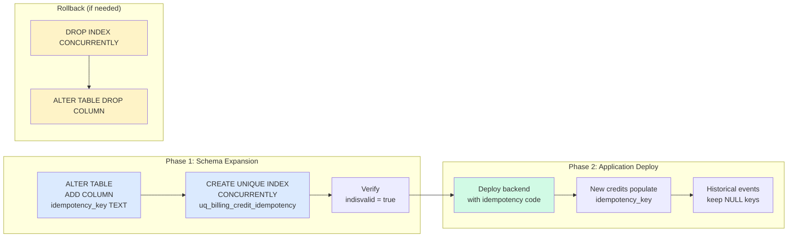

# Expand-then-Deploy Migration Sequence

## Key Properties

- **Instant column add:** Nullable columns with no default don't rewrite the table
- **Non-blocking index:** `CONCURRENTLY` avoids write locks during build
- **Backward compatible:** Old app ignores the column; new app handles NULL keys
- **Partial index:** `WHERE idempotency_key IS NOT NULL` excludes historical events
