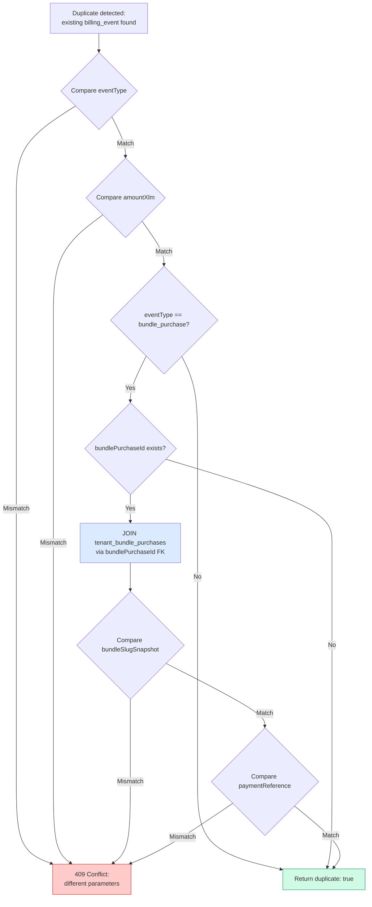

# Immutable Financial Request Fingerprint

## Fingerprint Fields

| Field | Table | Compared For | Null Handling |
|-------|-------|-------------|---------------|
| eventType | billing_events | All types | Never null |
| amountXlm | billing_events | All types | Never null |
| bundleSlugSnapshot | tenant_bundle_purchases | bundle_purchase only | `?? null` coalesce |
| paymentReference | tenant_bundle_purchases | bundle_purchase only | `?? null` coalesce |

**Not compared:** notes, createdBy (mutable metadata safe to vary on retry)
