# RBAC Enforcement Gap (SEC-01)

```mermaid
flowchart TD
    subgraph "Current State"
        REQ[Admin request] --> AUTH[verifyInternalAdmin]
        AUTH --> ROLE{Check role}
        ROLE -->|super_admin / platform_admin| ALL[Full access<br/>read + write]
        ROLE -->|account_manager / support_agent| READ[Read access<br/>ALL tenants]

        READ -.->|NOT checked| ASSIGN[(admin_tenant_assignments<br/>table exists but<br/>is never queried)]
    end

    subgraph "Expected State (SEC-01)"
        REQ2[Admin request] --> AUTH2[verifyInternalAdmin]
        AUTH2 --> ROLE2{Check role}
        ROLE2 -->|super_admin / platform_admin| ALL2[Full access<br/>all tenants]
        ROLE2 -->|account_manager / support_agent| SCOPE[Check assignment]
        SCOPE --> ASSIGN2[(admin_tenant_assignments)]
        ASSIGN2 --> SCOPED{Assigned to<br/>requested tenant?}
        SCOPED -->|Yes| ALLOWED[Scoped access]
        SCOPED -->|No| DENIED[403 Forbidden]
    end

    style ASSIGN fill:#fef3c7,stroke:#f59e0b
    style READ fill:#fecaca,stroke:#dc2626
    style DENIED fill:#fecaca,stroke:#dc2626
    style ALLOWED fill:#d1fae5,stroke:#059669
```

## Status: BLOCKED — requires product decision

| Option | Description | Effort |
|--------|-------------|--------|
| A | Enforce scoping in verifyInternalAdmin | Medium |
| B | Remove account_manager/support_agent roles | Low |
| C | Accept flat access model | None |
