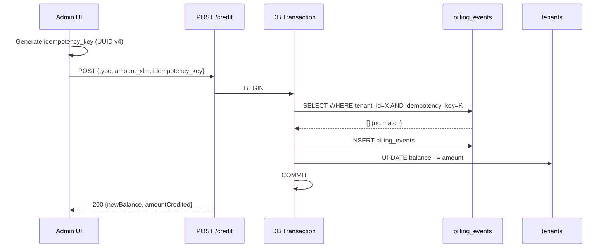
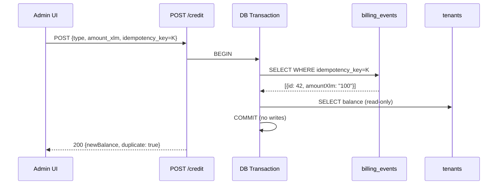

# 13-CREDIT-IDEMPOTENCY-SPEC: FIND-UI-004 — Duplicate Credit Posting Prevention

**Date:** 2026-10-20
**Branch:** `worktree-rbac-billing-audit-2026-10-20`
**Status:** DESIGN SPEC — requires review and backend migration approval before implementation

---

## 1. Problem Statement

The `POST /api/v1/internal/tenants/:id/credit` endpoint has **zero idempotency protection**. Any of the following scenarios would credit a tenant's balance twice:

1. **Double-click:** Admin submits, UI disables button, but a race condition submits two requests
2. **Network retry:** Request completes server-side but TCP response is lost; client retries
3. **Browser refresh:** Admin submits, then refreshes during the loading state
4. **Concurrent admin sessions:** Two admins both post the same credit at the same time

### Current Protections (Insufficient)

| Layer | Protection | Gap |
|-------|-----------|-----|
| UI button | `disabled={creditSubmitting}` | Only prevents same-session double-click; not network retries |
| UI confirmation dialog | Must click "Post credit" in modal | Prevents accidental single-click; not duplicate POSTs |
| Backend schema | No `idempotency_key` field | No way to detect duplicate requests |
| Database | No unique constraint on billing_events | Every INSERT succeeds regardless of duplicates |
| Transaction isolation | READ COMMITTED (default) | No serialization of concurrent credit requests |

---

## 2. Code Path Trace

```
Admin UI (AdminTenantDetail.tsx:153-180)
  → handlePostCredit()
    → adminFetch(`/tenants/${id}/credit`, { method: "POST", body: { type, amount_xlm, notes } })
      → Backend admin.ts:377-521
        → verifyInternalAdmin (JWT auth)
        → Role check (super_admin | platform_admin)
        → db.select() tenant existence check (OUTSIDE transaction)
        → db.transaction()
          → billing.service.ts writeBillingCredit():505-586
            → INSERT billing_events (no unique constraint)
            → UPDATE tenants SET prepaid_xlm_balance += amount
            → [if bundle_purchase] INSERT tenant_bundle_purchases
        → auditLog() (fire-and-forget, after commit)
```

### Key Observations

- **No FOR UPDATE lock** on the tenant row before the credit (unlike `checkWalletBillingTx` which uses `.for("update")`)
- **No pre-write duplicate check** — the function always inserts
- **READ COMMITTED isolation** — concurrent transactions don't block each other
- The `billing_events.id` is a serial PK — every insert generates a new unique ID
- The `billing_events` table has CHECK constraints on event type and non-zero amount, but **no uniqueness constraints**

### Existing Idempotency (For Comparison)

The monthly maintenance path **does** have idempotency:
- `monthlyMaintenanceSnapshots` table with `uq_maintenance_snapshot` UNIQUE on `(tenant_id, billing_period)` — schema line 1094
- Pre-transaction check at `billing.service.ts` line 614
- This pattern should be adapted for credit posting

---

## 3. Proposed Design

### 3.1 Idempotency Key Approach

**Client generates** a UUID v4 idempotency key per credit operation. The key is scoped to:
- Tenant ID
- Admin session (implicit via JWT)
- Specific credit operation (user clicks "Post credit" → key generated)

**Server enforces** uniqueness via a database constraint.

### 3.2 Schema Change

```sql
-- Add column to billing_events
ALTER TABLE billing_events
  ADD COLUMN idempotency_key TEXT;

-- Add unique constraint scoped to tenant + idempotency key
-- (Different tenants can have the same key — it's per-tenant)
CREATE UNIQUE INDEX uq_billing_credit_idempotency
  ON billing_events (tenant_id, idempotency_key)
  WHERE idempotency_key IS NOT NULL;
```

**Why partial unique index:** Historical events (before migration) have NULL keys, and non-credit events (auto-generated maintenance, activation) don't need idempotency keys. The `WHERE NOT NULL` clause ensures backward compatibility.

### 3.3 API Change

**Request body addition:**
```json
{
  "type": "manual_topup",
  "amount_xlm": 100,
  "notes": "Monthly allocation",
  "idempotency_key": "550e8400-e29b-41d4-a716-446655440000"
}
```

**Validation rules:**
- `idempotency_key` is **required** for all credit POSTs (breaking change — coordinate with any external API clients)
- Format: UUID v4 string (36 chars)
- Max length: 36
- The key is stored in `billing_events.idempotency_key`

### 3.4 Server-Side Enforcement

```typescript
// In writeBillingCredit(), before the INSERT:
const existing = await tx
  .select({ id: schema.billingEvents.id, amountXlm: schema.billingEvents.amountXlm })
  .from(schema.billingEvents)
  .where(and(
    eq(schema.billingEvents.tenantId, tenantId),
    eq(schema.billingEvents.idempotencyKey, idempotencyKey),
  ))
  .limit(1);

if (existing.length > 0) {
  // Duplicate request — return the original result without modifying balance
  const currentBalance = await tx
    .select({ balance: schema.tenants.prepaidXlmBalance })
    .from(schema.tenants)
    .where(eq(schema.tenants.id, tenantId));
  return {
    duplicate: true,
    billingEventId: existing[0].id,
    amountCredited: existing[0].amountXlm,
    newBalance: currentBalance[0].balance,
  };
}

// Proceed with normal INSERT + balance UPDATE
```

**Concurrent duplicate handling:** The UNIQUE index `uq_billing_credit_idempotency` catches race conditions where two requests with the same key pass the SELECT check simultaneously. The second INSERT fails with a unique constraint violation → the transaction is rolled back → the handler returns the original event's result via a retry-read.

### 3.5 Response for Duplicate Requests

Duplicate requests return **HTTP 200** (not 409) with the original result, making retries safe:

```json
{
  "tenantId": 1,
  "billingEventId": 42,
  "newBalance": "600.0000000",
  "amountCredited": "100.0000000",
  "eventType": "manual_topup",
  "duplicate": true
}
```

The `duplicate: true` flag is informational. The client can display "Credit already posted" instead of a success animation.

### 3.6 Changed-Payload Duplicate Detection

If a request arrives with a known idempotency key but **different** amount/type:
- Return **HTTP 409 Conflict** with `{ "error": "Idempotency key already used with different parameters" }`
- The original event's amount takes precedence — never modify it

### 3.7 Frontend Change

```typescript
// In handlePostCredit():
const idempotencyKey = crypto.randomUUID();

const res = await adminFetch(`/api/v1/internal/tenants/${id}/credit`, {
  method: "POST",
  body: JSON.stringify({
    type: creditType,
    amount_xlm: amount,
    notes: creditNotes || undefined,
    idempotency_key: idempotencyKey,
  }),
});
```

Key generation happens **once per user action** (when "Post credit" is confirmed in the dialog). If the request fails with a network error, the same key is reused for the retry.

---

## 4. Migration Plan

### 4.1 Database Migration

```sql
-- Step 1: Add nullable column (backward-compatible)
ALTER TABLE billing_events ADD COLUMN idempotency_key TEXT;

-- Step 2: Create partial unique index
CREATE UNIQUE INDEX CONCURRENTLY uq_billing_credit_idempotency
  ON billing_events (tenant_id, idempotency_key)
  WHERE idempotency_key IS NOT NULL;
```

`CONCURRENTLY` avoids locking the billing_events table during index creation.

### 4.2 Backward Compatibility

- Existing billing events (before migration) have `idempotency_key = NULL` — no conflict with the partial unique index
- Auto-generated events (maintenance, activation) continue to have NULL keys — the index only applies when a key is provided
- The API change (requiring `idempotency_key` on credit POST) is a breaking change for any external consumers of this endpoint — verify no external integrations exist

### 4.3 Rollback Plan

```sql
DROP INDEX CONCURRENTLY uq_billing_credit_idempotency;
ALTER TABLE billing_events DROP COLUMN idempotency_key;
```

The backend route would need to stop requiring `idempotency_key` in the schema validation.

---

## 5. Regression Test Cases

### 5.1 Happy Path
- POST credit with idempotency key → 200, balance increased, event created
- Verify `idempotency_key` stored in billing_events row

### 5.2 Exact Duplicate (Same Key, Same Params)
- POST credit with key X → 200, balance +100
- POST credit with key X again → 200, balance unchanged, `duplicate: true`
- Verify only ONE billing_events row exists for key X

### 5.3 Changed Payload (Same Key, Different Amount)
- POST credit with key X, amount 100 → 200
- POST credit with key X, amount 200 → 409 Conflict
- Verify balance was credited only once (100), not 200

### 5.4 Concurrent Duplicate
- Simultaneously POST two requests with the same key X
- Exactly one succeeds, the other returns either the duplicate response or a retry
- Verify ONE billing_events row, ONE balance increment

### 5.5 Different Keys (Not Duplicate)
- POST credit with key A → 200, balance +100
- POST credit with key B → 200, balance +200
- Verify TWO billing_events rows, total balance +200

### 5.6 Network Retry Safety
- POST credit with key X → server commits but response lost
- Client retries with same key X → 200, `duplicate: true`
- Balance was credited exactly once

### 5.7 Cross-Tenant Key Reuse
- POST credit to tenant 1 with key X → 200
- POST credit to tenant 2 with key X → 200 (different tenant, no conflict)
- Both tenants credited correctly

### 5.8 Backward Compatibility
- Verify existing billing_events (NULL idempotency_key) are unaffected
- Verify maintenance/activation events (no key) still work

---

## 6. Sequence Diagrams

### 6.1 Normal Credit Request



### 6.2 Duplicate Request (Network Retry)



### 6.3 Concurrent Duplicate Requests

```mermaid
sequenceDiagram
    participant A as Request A
    participant B as Request B
    participant DB as PostgreSQL

    A->>DB: BEGIN; SELECT (no match for key K)
    B->>DB: BEGIN; SELECT (no match for key K)
    A->>DB: INSERT billing_events (key=K) → SUCCESS
    A->>DB: UPDATE balance → COMMIT
    B->>DB: INSERT billing_events (key=K) → UNIQUE VIOLATION
    B->>DB: ROLLBACK
    B->>DB: BEGIN; SELECT (match found for key K)
    B->>DB: Read original event → COMMIT
    Note over B: Return duplicate: true
```

---

## 7. Decision Required

**This spec proposes a database schema change and API contract change.** Implementation requires:

1. **Schema migration approval** — Adding `idempotency_key` column + unique index to `billing_events`
2. **API contract review** — Making `idempotency_key` required on credit POST
3. **External integration check** — Verify no external systems call this endpoint directly

**No code changes should be made until this design is reviewed and approved.**

The frontend confirmation dialog (FIND-UI-003, already implemented) and button-disable pattern provide adequate protection against casual double-clicks. The idempotency spec addresses the harder cases: network retries, browser refresh, and concurrent admin sessions.

### Risk Without Implementation

| Scenario | Likelihood | Impact |
|----------|-----------|--------|
| Double-click (same session) | Low (button disabled) | Medium (double credit) |
| Network retry | Low | High (silent double credit, no error) |
| Browser refresh during submit | Very Low | High (silent double credit) |
| Concurrent admin sessions | Very Low | High (double credit, no detection) |

**Overall risk: LOW likelihood, HIGH impact per-incident.** Recommended for implementation before the credit volume increases.
